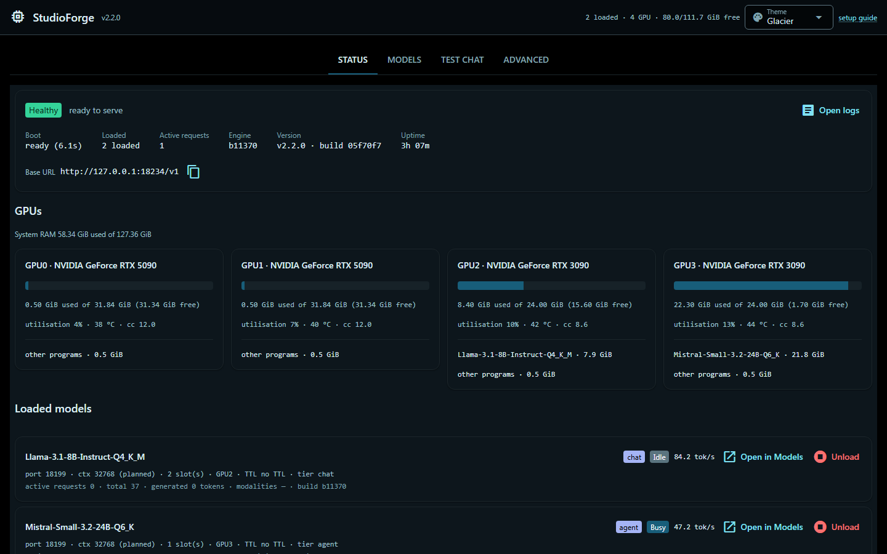
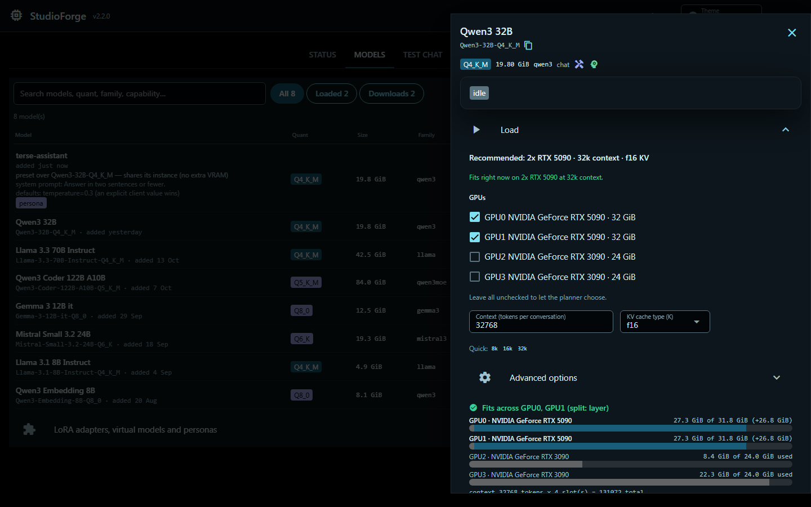
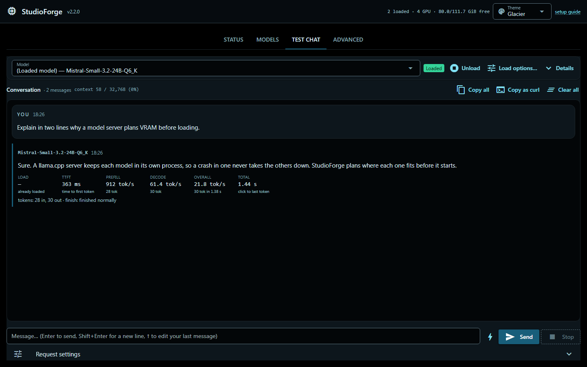
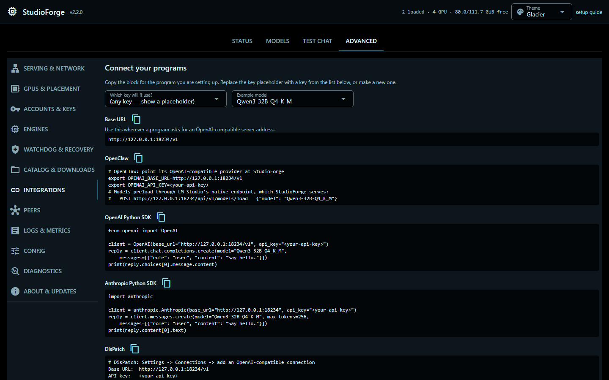
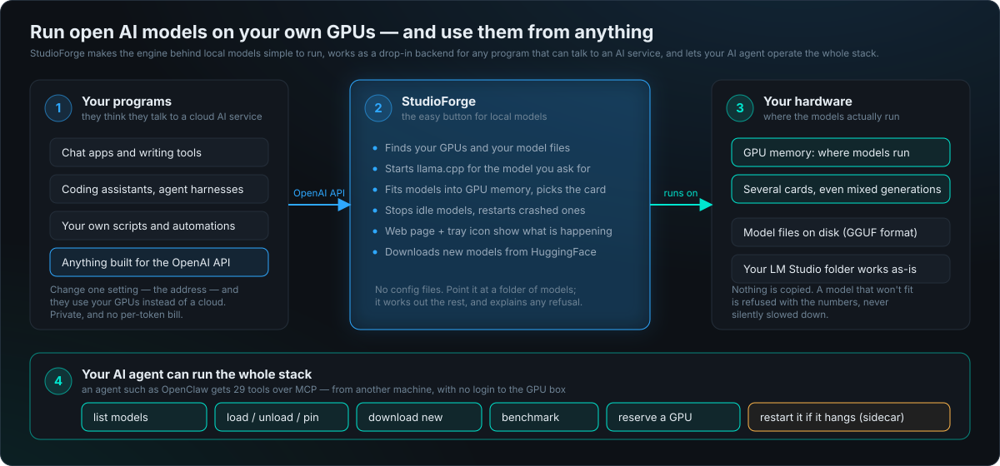
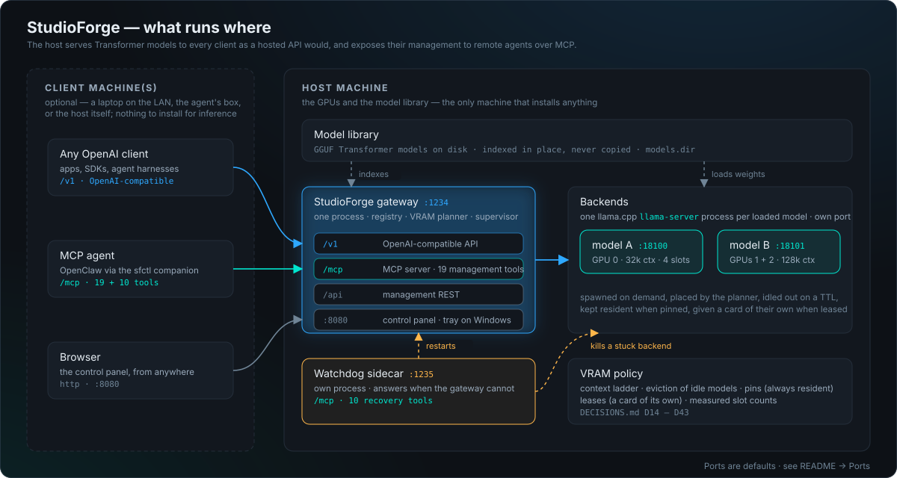
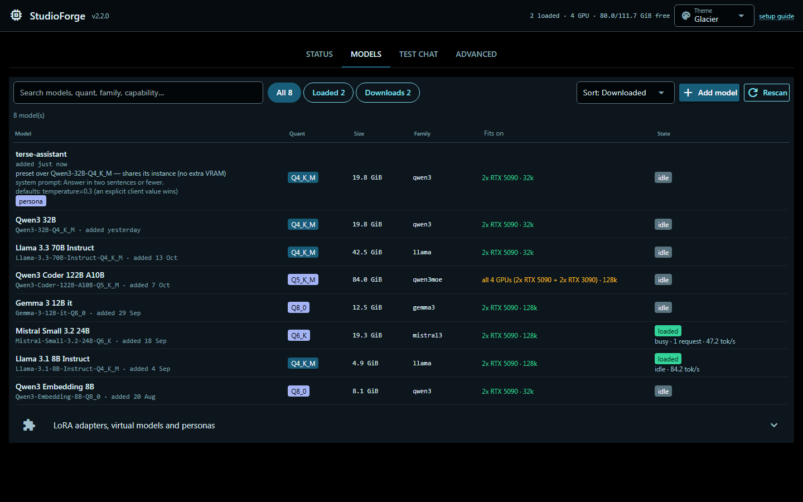
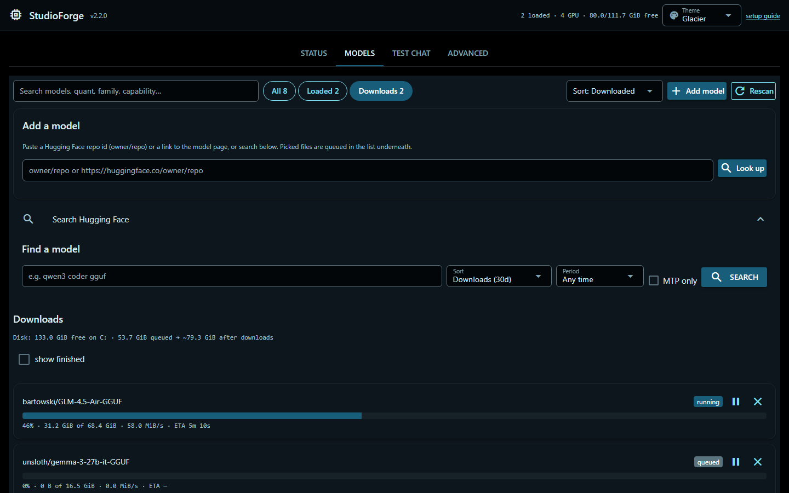
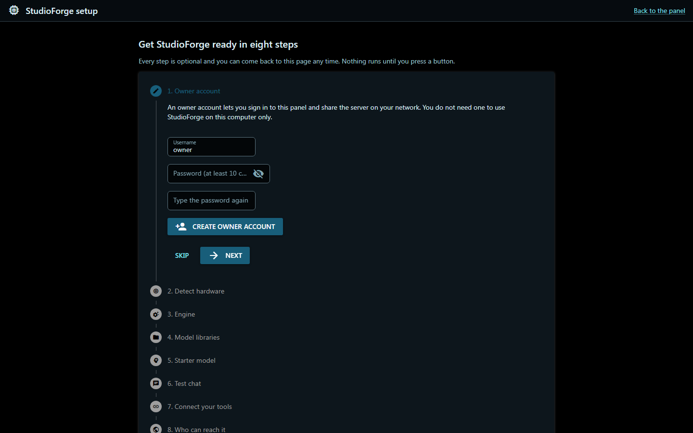
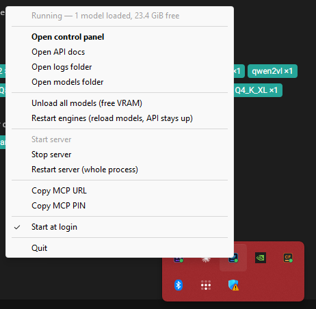

# StudioForge

[](https://github.com/LaserLloyd/StudioForge/actions/workflows/ci.yml)
[](LICENSE)


<table>
  <tr>
    <td width="50%"><br><sub><b>Status.</b> Health, every GPU and what is on it, and the loaded models: busy or idle, tokens per second. Nothing to configure here.</sub></td>
    <td width="50%"><br><sub><b>Models.</b> One searchable table and a details drawer per model: the planner's recommended GPUs, context and KV type are pre-filled, and the fit is drawn per GPU before you press Load.</sub></td>
  </tr>
  <tr>
    <td width="50%"><br><sub><b>Test Chat.</b> Talk to a loaded model: streaming reply with time to first token and tokens per second, and a copy-as-curl button.</sub></td>
    <td width="50%"><br><sub><b>Advanced.</b> Everything else, in a left menu: serving and network, accounts and keys, engines, watchdog, integrations, logs, config, diagnostics.</sub></td>
  </tr>
</table>

Run a computer as an AI server: a llama.cpp backend with an MCP control plane in front that automatically optimizes, loads and evicts models. Designed for a dedicated server machine or for other programs to call. OpenAI-compatible.

**StudioForge is a self-hosted, GPU-only llama.cpp server for Windows and Linux**: an
OpenAI-compatible gateway over [llama.cpp](https://github.com/ggml-org/llama.cpp)'s `llama-server`,
with a model registry, a VRAM planner, GPU leases for the other programs sharing the cards, a web
control panel, a system tray, and MCP tools so an agent can run it from another machine. Built to
replace LM Studio as the backend for [OpenClaw](docs/OPENCLAW.md) — it listens on LM Studio's port, so
switching is a host change, not a rewrite.

**Status:** v2.2.0. The first release on the new scheme: secure-by-default binds, scoped keys,
backend-aware engines (CUDA verified; ROCm and Vulkan not yet tested on real hardware, see
[`docs/ENGINES.md`](docs/ENGINES.md)) and the LM Studio native API (see [`CHANGELOG.md`](CHANGELOG.md), **BREAKING**
first). Windows is the reference platform and runs it daily; Linux is supported (CI runs both) and
less battle-tested. Questions and bug reports: [Contact](#contact).

**Read more:** [the StudioForge write-up](https://www.laserlloyd.com/projects/studioforge-gpu-only-llm-server/)
on LaserLloyd.com, and the author's other [AI projects](https://www.laserlloyd.com/ai/).

**On versions.** StudioForge uses semantic versioning since 2.0.0. The version lives in
`src/studioforge/__init__.py` — `2.2.0` — and is what `GET /api/version`, `GET /health`, the MCP
`server_status` tool and `sfctl status` report; all three `pyproject.toml` files (the app,
`packages/studioforge-companion` for `sfctl`, and `packages/studioforge-tenant`) carry the same string,
the companion ships from the same release and carries the same version, and release tags are
`v2.2.0`. Releases before 2.0.0 were calendar-versioned (`1.26-08-23` style); the updater reads both
schemes, so a 1.x install sees 2.0.0 as the update it is. Check what a server is actually running with
`curl -s <host>/api/version`. A server running a commit past its release still reports that release,
but the `build` field beside `version` (on `/health`, `/api/version`, `/api/status`, `server_status`
and the "starting" log line) names the checkout itself: the short commit SHA, `-dirty`
when tracked files carry uncommitted changes, or `unknown` from a wheel or without git. To branch on
behaviour, **feature-gate on `GET /api/capabilities` instead**: its `implemented` block lists every decision
number the build includes (`"D61" in implemented.decisions`) and named behaviours
(`"plan_recommended" in implemented.features`), and is never behind the code (DECISIONS.md D64).

---

## Overview

### In plain English

<p align="center"></p>

Three ideas: your programs keep talking to the API they already know and just get a new address;
StudioForge runs the engine behind local models for you — finding GPUs and model files, fitting
models into memory, restarting what crashes — so you never write a config file; and your AI agent
can operate all of it from another machine. The rest of this section is the technical version.

### Technical brief

**Why it exists.** Running Transformer models on your own GPUs leaves you without the operational
layer a hosted API takes for granted: an endpoint every client already speaks, capacity planning
across the cards, recovery when a process wedges, and — above all — *remote* management, so the
machine running your agent is not the machine running your models. StudioForge is that layer. It
puts llama.cpp backends (one `llama-server` process per loaded GGUF model) behind the OpenAI API,
and puts their **management** — load, unload, pin, benchmark, lease GPUs, recover — behind
[MCP](https://modelcontextprotocol.io), so an agent such as OpenClaw can operate the GPU host from
another machine with no shell on it.

**What it is not.** It does no inference of its own, it never offloads to CPU, and it never phones
home: a model runs entirely in VRAM or is refused with the numbers, and the only outbound requests
are the ones you ask for.

**Sharing the GPUs.** Other programs on the same box -- an image server, a speech server -- take
GPU **leases** from StudioForge before they allocate, and StudioForge plans around them. The
contract they follow, the registry that lists them with live health, and the SDK they adopt are
the [VRAM Tenant Protocol](docs/TENANTS.md). StudioForge never starts or stops one of them.

<p align="center"></p>

### Components

| Component | Runs on | Role |
| --- | --- | --- |
| **Host machine** | The box with the NVIDIA GPUs and the GGUF library | Runs everything below. The only machine that installs anything. |
| **Gateway** (`:1234`, one process) | Host | Four surfaces: `/v1` the OpenAI-compatible API; `/mcp` an MCP server with 23 management tools; `/api` the management REST; `:8080` the control panel (plus a system tray on Windows). Inside: the registry, the VRAM planner and the supervisor. |
| **Backends** — `llama-server` | Host, one process per loaded model, each on its own internal port | [llama.cpp](https://github.com/ggml-org/llama.cpp)'s server, pinned to a tested build and fetched automatically. Spawned on demand, placed by the planner, idled out on a TTL, kept resident when pinned, given a card of their own when leased. A crash takes down one model, never the gateway. |
| **Model library** | Host, on disk (`models.dir`) | Your GGUF Transformer models, indexed in place — the same folder LM Studio uses; nothing is copied or moved. |
| **Watchdog sidecar** (`:1235`) | Host, a separate process | Its **own MCP server** with 10 recovery tools — restart the gateway, kill a stuck backend, reclaim VRAM, tail logs — reachable when the gateway is wedged, because it is not the gateway. |
| **VRAM policy** | Host, inside the planner | The context ladder, eviction of idle models, pins, leases and measured slot counts — every rule with its measurement in [`DECISIONS.md`](DECISIONS.md) D14–D43. |
| **Client machine(s)** | Anything on the LAN or tailnet — a laptop, a NAS, the agent's box; or the host itself | Nothing to install for inference: any OpenAI client points at `:1234/v1`. For management, the [`sfctl` companion](#the-companion-sfctl) (no GPU, no CUDA) bridges both MCP servers into one toolset. |

### How a request flows

1. A client `POST`s to `/v1/chat/completions` naming a model — or `local-model`, which resolves to
   `models.default_model` (so do `default`/`auto`/`current`), or `loaded`, which resolves instead
   to the largest model already resident that can serve this route's kind of request (a chat model,
   here — `/v1/embeddings` and `/v1/rerank` resolve `loaded` against their own kind). It is a live
   read of the supervisor, not the static default. Nothing of that kind resident is a 404 naming
   the remedy; one of that kind still loading is a 503 with a `Retry-After`. See [`docs/OPENCLAW.md`](docs/OPENCLAW.md#zero-config-inference-a-default-model)
   for the full contract.
2. The gateway looks the model up in the registry. If a backend is already serving it, the request
   is proxied straight through, streaming intact.
3. Otherwise the VRAM planner chooses a placement: which GPUs, what context (walking a ladder down
   from `models.target_ctx` until it fits), which KV cache type, how many parallel slots. It may
   evict *idle* models when policy allows; it never touches a pinned model, a leased card, or a
   model mid-request.
4. The supervisor spawns a `llama-server` on an internal port, waits for it to pass health, and the
   request proceeds. The backend idles out after its TTL unless pinned.
5. Everything else — loading ahead of time, pinning, leasing a card, benchmarking, downloading —
   happens over `/mcp` or `/api`; if the gateway itself stops answering, the sidecar's tools on
   `:1235` restart it.

### Why it is worth running

- **It tells the truth about VRAM.** A model runs entirely on GPU or it is refused with the
  numbers and a fix — never silently spilled to CPU at a twentieth of the speed.
- **Multi-GPU is planned, not guessed.** Placement across mixed cards, context sized to what
  fits, measured slot counts, pins for models that must always be warm, and leases that give a
  model a card of its own ([`DECISIONS.md`](DECISIONS.md) D14–D43, each with its measurement).
- **The chat model comes first.** A load can say what it is — `priority: 1` the model a person
  is chatting with, `2` a dispatched agent, `3` (or nothing) background. A chat load takes the
  fastest placement (idle background models are moved off its cards and reloaded afterwards
  where they fit), jumps the load queue, and holds background traffic off while it loads;
  background can never displace it. The tier is saved per model (`settings.priority`), so it
  survives a restart instead of quietly falling back to background; a single request can state
  its own tier in the body of a chat completion; and traffic held off while a better-tier load
  runs is refused with the distinct code `priority_hold` and a `Retry-After` worth honouring
  ([`DECISIONS.md`](DECISIONS.md) D46, D48).
- **Drop-in for LM Studio.** Same port, same `/v1/models` behaviour, same library on disk —
  switching a client is a host change.
- **Built for agents.** 33 MCP tools with a catalog that hands an agent the exact load
  arguments, a benchmarking playbook it can follow, and recovery tools that survive a wedged server.
- **One call answers "do I even need to load anything?"** `check_loaded_model(min_params="20b",
  vision=true)` asks whether what is *already* resident clears the bar — size, and capabilities
  like vision, tools, thinking or uncensored — and a yes comes back with the model id to send the
  work to, so an agent skips a 40-second load or a cloud fallback it did not need. Nothing the
  server cannot prove is allowed to pass ([`DECISIONS.md`](DECISIONS.md) D52).
- **Recovers on its own.** Tray, watchdog, crash restarts with backoff, and VRAM that cannot
  outlive its owner process.
- **Private by construction.** Nothing leaves the box unless you ask for it.

### Where to go next

| You want to… | Go to |
| --- | --- |
| Install it on the host | [Install](#install) — [Windows](#windows) · [Linux](#linux) |
| Have an AI coding agent install it for you | [A. Let an AI coding agent do it](#a-let-an-ai-coding-agent-do-it) |
| Call it from an app or SDK | [B. Manually, as an API](#b-manually-as-an-api-any-openai-compatible-client) |
| Drive it from OpenClaw / an MCP agent | [C. With OpenClaw](#c-with-openclaw-or-any-mcp-agent) · [the companion](#the-companion-sfctl) |
| See the control panel | [What it looks like](#what-it-looks-like) |
| Know which ports to open | [Ports](#ports) |
| Keep your data outside the checkout | [Data directory](#data-directory) |
| Forgot the panel password, add or delete a login | [Accounts and lockout recovery](#accounts-and-lockout-recovery) |
| Double-click instead of typing | [Windows launchers](#windows-launchers) |
| Read more | [Documentation](#documentation) |
| Ask a question or report a bug | [Contact](#contact) |

---

## Install

Pick your platform below. Methods are listed simplest first, and each block runs top to bottom on a
fresh machine. StudioForge serves models from GPU memory only. NVIDIA (CUDA) is the tested path; the
AMD (ROCm) and Vulkan images build and boot but have not been run on real AMD or Intel hardware.
With no usable GPU the server still starts and reports `can_serve=false`.

**Ports:** `1234` gateway (`/v1`, `/api`, `/mcp`, `/health`), `8080` control panel, `1235` watchdog
sidecar. All three bind `127.0.0.1` unless you change it (see [Ports](#ports)). LM Studio also uses
`1234`: quit it first. In the Docker methods these are the container ports; change the host side with
`SF_GATEWAY_PORT`, `SF_PANEL_PORT` and `SF_WATCHDOG_PORT` in `.env`.

### Windows

You need an NVIDIA driver from the 580 series or newer for the CUDA 13 engine builds (no CUDA toolkit
needed: the prebuilt engine ships its runtime).

#### 1. Git + uv, run from a clone (simplest)

Choose this for one Windows PC with an NVIDIA GPU. It uses the prebuilt llama.cpp engine, and
`launchers\` adds a tray icon and start-at-login.

```powershell
winget install --id Git.Git -e
winget install --id astral-sh.uv -e
```

Close PowerShell and open a new window so `git` and `uv` are on `PATH`, then:

```powershell
git clone https://github.com/LaserLloyd/StudioForge.git
cd StudioForge
uv venv --python 3.12 .venv
uv pip install --python .venv\Scripts\python.exe -e .
.venv\Scripts\python.exe -m studioforge serve --open
```

The first start downloads the pinned llama.cpp engine and checks its checksum. `serve --open` stays in
the foreground and opens the control panel at <http://127.0.0.1:8080>. To check it, open a second
PowerShell window:

```powershell
curl.exe -s http://127.0.0.1:1234/health
```

The panel's setup guide creates the owner account in its first step. To do that from the terminal instead
(pick your own password, 10 or more characters; this also downloads and smoke-tests the llama.cpp engine),
run this before the first `serve`:

```powershell
$env:SF_OWNER_PASSWORD = "choose-a-password"
.venv\Scripts\python.exe -m studioforge setup --non-interactive --username owner --password-env SF_OWNER_PASSWORD --skip-model --skip-chat --no-start
```

The options of every command are in [`docs/CLI.md`](docs/CLI.md), and [`docs/SETUP.md`](docs/SETUP.md) walks
through the same first run.

A later `studioforge engine --update` installs the newest llama.cpp build your driver can run and
smoke-tests it before activating. The full smoke test micro-loads one small GGUF from your library;
with an empty library it runs `llama-server --version` and `--list-devices` only, records
`binary-only (no model available)` and still activates, and the next engine check with a model
present runs the real micro-load. Prefer double-clicking? `launchers\Update StudioForge.bat`
does the venv, install and engine steps,
`launchers\Start StudioForge.bat` starts the server, and `launchers\StudioForge Tray.bat` runs it from
the notification area (see [Windows launchers](#windows-launchers)).

| Pros | Cons |
| --- | --- |
| Fewest steps, no container layer | You update Python packages and the engine yourself |
| Prebuilt engine, nothing to compile | Windows only; data lives in `data\` inside the clone unless you set `SF_DATA_DIR` |
| Tray, autostart and Update launchers included | Runs as your user, not isolated from the rest of the PC |

#### 2. Docker Desktop

Choose this to keep StudioForge in a container with its data on a Docker volume. The container is
Linux, so the llama.cpp engine is compiled inside it on the first start (several minutes of CPU) and
the image that can do that is large (about 14 GB).

```powershell
winget install --id Docker.DockerDesktop -e
winget install --id Git.Git -e
```

Start Docker Desktop once and accept its first-run prompts (WSL 2 backend; the Windows NVIDIA driver
gives containers GPU access). Then, in a new PowerShell window:

```powershell
git clone https://github.com/LaserLloyd/StudioForge.git
cd StudioForge\deploy\compose
@"
SF_BACKEND=cuda-devel
SF_MODELS=C:/Users/you/models
SF_OWNER_PASSWORD=change-this-password
"@ | Set-Content .env
docker build --build-arg BACKEND=cuda --build-arg CUDA_FLAVOR=devel --build-arg VERSION=2.0.0 -t ghcr.io/laserlloyd/studioforge:2.0.0-cuda-devel ..\..
docker compose -f compose.yml -f compose.cuda.yml up -d
docker compose ps
curl.exe -s http://127.0.0.1:1234/health
```

Edit the `SF_MODELS` path (your GGUF folder) and `SF_OWNER_PASSWORD` (10 or more characters) before you
run it. Open <http://localhost:8080> and sign in as `owner` with that password; create one key per
client under **Advanced > Accounts & keys**, and point clients at `http://localhost:1234/v1`. Leave
`SF_OWNER_PASSWORD` out and the container generates one into `/data/owner-password.initial` on the
volume. Once the image is published to the registry, replace the `docker build` line with
`docker compose -f compose.yml -f compose.cuda.yml pull`. Do not add `--build` to `up` (see the Linux note below).

| Pros | Cons |
| --- | --- |
| Data on a named volume, read-only image, pre-migration snapshots | About 14 GB image; engine compiles on first start |
| Easy upgrade and rollback by tag | Needs Docker Desktop and its NVIDIA/WSL 2 GPU setup |
| Nothing installed on Windows besides Docker | No tray icon; Docker Desktop must be running |

### Linux

Ubuntu and Debian package names are shown; use your distribution's equivalents. NVIDIA is the tested
GPU path. On Linux the pinned llama.cpp engine for NVIDIA is **built from source on the first start**
(minutes of CPU, once per version), which needs `git`, `cmake`, a compiler and a CUDA toolkit whose
`nvcc` matches your driver ([download](https://developer.nvidia.com/cuda-downloads)). The container
method brings its own toolchain.
AMD (ROCm) and Vulkan are untested on hardware.

#### 1. Installer script with a systemd user service (simplest)

Choose this for a Linux box you want StudioForge to run on at login, with no `sudo` after the
prerequisites. It installs `uv` if you lack it, makes a Python 3.12 environment under your home
directory, and writes and starts two systemd **user** units (gateway and watchdog).

```bash
sudo apt-get update && sudo apt-get install -y git curl ca-certificates cmake build-essential
git clone https://github.com/LaserLloyd/StudioForge.git
cd StudioForge
deploy/linux/install.sh --from .
export PATH="$HOME/.local/bin:$PATH"
studioforge version
curl --retry 20 --retry-connrefused -s http://127.0.0.1:1234/health
```

The service builds the engine on its first start; follow it with `journalctl --user -u studioforge -f`
(`/health` reports `can_serve=false` until the engine and a model are in place). Skip the CUDA toolkit
and use method 2 if you would rather not install one. Avoid `studioforge engine --update` on Linux for
now: it fetches an upstream CUDA archive whose smoke test failed in our container test. Add `sudo loginctl enable-linger "$USER"` so the services keep running when
you are logged out. The control panel is <http://localhost:8080>. Read the script first with
`less deploy/linux/install.sh`, preview it with `--dry-run`, or use `--system` (run as root) for a
system-wide install under `/opt/studioforge`. When a GitHub release exists you can skip the clone:
`curl -fsSL https://raw.githubusercontent.com/LaserLloyd/StudioForge/main/deploy/linux/install.sh | bash`
installs the latest release wheel after checking it against `SHA256SUMS.txt`.

| Pros | Cons |
| --- | --- |
| Autostart, restart on failure and a watchdog, as user units | You install the CUDA toolkit for the engine build |
| User-level: nothing outside your home directory, no `sudo` for the install | Needs a systemd user session (without one the script writes the units but cannot enable them, and says so) |
| `--uninstall` removes the program and keeps your data | A script writes units for you; read it or use `--dry-run` first |

#### 2. Docker or Podman Compose

Choose this for isolation, a data volume that survives updates, and no CUDA toolkit on the host. It
needs Docker with the [NVIDIA Container Toolkit](https://docs.nvidia.com/datacenter/cloud-native/container-toolkit/latest/install-guide.html)
(the `nvidia-ctk runtime configure --runtime=docker` step), or Podman with a CDI spec.

```bash
sudo apt-get update && sudo apt-get install -y git curl ca-certificates
curl -fsSL https://get.docker.com | sh
git clone https://github.com/LaserLloyd/StudioForge.git
cd StudioForge/deploy/compose
mkdir -p models
cat > .env <<'EOF'
SF_BACKEND=cuda-devel
SF_MODELS=./models
SF_OWNER_PASSWORD=change-this-password
EOF
sudo docker build --build-arg BACKEND=cuda --build-arg CUDA_FLAVOR=devel --build-arg VERSION=2.0.0 -t ghcr.io/laserlloyd/studioforge:2.0.0-cuda-devel ../..
sudo docker compose -f compose.yml -f compose.cuda.yml up -d
sudo docker compose ps
curl --retry 20 --retry-connrefused -s http://127.0.0.1:1234/health
```

Put your GGUF files in `models/` (or set `SF_MODELS`), and choose your own `SF_OWNER_PASSWORD` (10 or
more characters; leave it out to get a generated one in `/data/owner-password.initial`). Sign in at
<http://localhost:8080>. The slim `-cuda` image cannot compile the engine: use `-cuda-devel` as above,
or mount an engine you built once. Podman: `podman-compose -f compose.yml -f compose.cuda.podman.yml up -d`.
Do not add `--build` to `up`: compose passes `SF_BACKEND` as the build argument, which only accepts
`cuda`, `rocm` or `vulkan`. Once the image is published, replace the `docker build` line with `pull`. Full guide, the AMD and
Vulkan overrides, and offline use: [docs/deploy/docker.md](docs/deploy/docker.md).

| Pros | Cons |
| --- | --- |
| Data on the `studioforge-data` volume, read-only image, snapshot before each migration | About 14 GB devel image; first start compiles the engine |
| Upgrade is a pull and `up -d`; rollback is the previous tag | Needs the NVIDIA Container Toolkit (or a CDI spec on Podman) |
| No CUDA toolkit or Python on the host | No tray; models folder is mounted read-only |

#### 3. From a clone with uv, no service (hackable)

Choose this to read or change the code, or to run it in a terminal. Same prerequisites as method 1.

```bash
sudo apt-get update && sudo apt-get install -y git curl ca-certificates cmake build-essential
curl -LsSf https://astral.sh/uv/install.sh | sh
source "$HOME/.local/bin/env"
git clone https://github.com/LaserLloyd/StudioForge.git
cd StudioForge
uv venv --python 3.12 .venv
uv pip install --python .venv/bin/python -e ".[dev]"
.venv/bin/studioforge serve
```

In a second terminal: `curl -s http://127.0.0.1:1234/health`. The first start builds the engine; watch the
progress in the first terminal. To run it as a service later, use the units in [`deploy/`](deploy/README.md).

| Pros | Cons |
| --- | --- |
| Editable install: change the code and restart | Most steps; you manage Python, uv and the CUDA toolkit |
| Nothing written outside the clone and the data folder | No autostart until you add the systemd units yourself |

### macOS

Not supported. StudioForge's engines are CUDA, ROCm and Vulkan builds of llama.cpp, the installer
refuses to run on anything but Linux, and Docker Desktop on a Mac cannot pass a GPU into a container.

### Upgrade and uninstall

| Method | Upgrade | Uninstall (your data is kept unless noted) |
| --- | --- | --- |
| Windows, clone | `git pull`, then `uv pip install --python .venv\Scripts\python.exe -e .`; stop the server first | `studioforge autostart disable` if you enabled it, then delete the folder. **Data is in `data\` inside the clone** unless `SF_DATA_DIR` points elsewhere: copy it out first |
| Docker (Windows or Linux) | `git pull`, rebuild the image (or `docker compose pull` once it is published), then `docker compose up -d`. Roll back by setting `SF_VERSION` to the previous tag. The entrypoint snapshots `registry.sqlite3` and `config.yaml` to `/data/backups/` first | `docker compose down` keeps the `studioforge-data` volume; `docker compose down -v` deletes it. Backup and restore: [docs/deploy/docker.md](docs/deploy/docker.md#backup-and-restore) |
| Linux installer | `git pull`, then `deploy/linux/install.sh --from .` again (replaces the program, keeps data); roll back with `git checkout <older tag>` and the same command | `deploy/linux/install.sh --uninstall`; data stays in `~/.local/share/studioforge` |
| Linux, clone | `git pull`, then `uv pip install --python .venv/bin/python -e ".[dev]"` | Delete the clone; data is in `data/` inside it unless `SF_DATA_DIR` is set |

### First run, any platform

The panel opens on **Status** with a *Finish setup* banner that leads to the setup guide
(`/setup`, or `studioforge setup` in a terminal): owner account, hardware, engine, model library
(**Detect LM Studio library** finds an existing one — models are indexed in place, never copied),
a starter model, a test chat, integration snippets and network exposure. Every step is optional on a
local-only install. The page-by-page reference, with the headless YAML/CLI equivalent, is
[`docs/SETUP.md`](docs/SETUP.md).

---

## Three ways to set it up

Install once (above), then pick whichever of these matches how you will use it — or let an agent
do the install for you.

### A. Let an AI coding agent do it

Open [Claude Code](https://docs.anthropic.com/en/docs/claude-code), a DeepSeek-based harness, or
any coding agent that can run shell commands **in the cloned folder**, and paste:

> Install StudioForge on this machine by following `docs/SETUP.md`: create the virtualenv with uv,
> install the llama.cpp engine with `studioforge engine --update`, point `models.dir` at my GGUF
> library, start it with `studioforge serve --open`, and confirm `GET http://127.0.0.1:1234/health`
> reports `"can_serve": true`. Only run `tests/unit`, never `tests/contract`.

The repo is written for that: [`DECISIONS.md`](DECISIONS.md) explains every non-obvious rule,
[`docs/RUNBOOK.md`](docs/RUNBOOK.md) says what each `/health` field means, and
[`docs/BENCHMARKING.md`](docs/BENCHMARKING.md) is a playbook an agent can follow verbatim.

### B. Manually, as an API (any OpenAI-compatible client)

Once the server is up, it *is* a cloud-style API on your own hardware. Point any OpenAI client at it:

```bash
export OPENAI_BASE_URL=http://<studioforge-host>:1234/v1
export OPENAI_API_KEY=not-required        # any non-empty string while server.api_key is unset
```

```bash
curl http://<studioforge-host>:1234/v1/chat/completions \
  -H "Content-Type: application/json" \
  -d '{"model": "<id from /v1/models>", "messages": [{"role": "user", "content": "hello"}]}'
```

```python
from openai import OpenAI  # https://github.com/openai/openai-python
client = OpenAI(base_url="http://<studioforge-host>:1234/v1", api_key="not-required")  # scrub-ok: the literal string clients send when auth is off
print(client.models.list())   # every downloaded model; naming an unloaded one loads it on demand
```

`GET /v1/models` lists every **downloaded** model, like LM Studio, and a request that names an
unloaded model just-in-time loads it. All three services listen on this machine only until you say
otherwise: to use it from another machine run `studioforge setup` (account, HTTPS, an admin key),
give each client its own key (`studioforge keys create`) and pass it as the `api_key` — see
[`docs/SECURITY.md`](docs/SECURITY.md) and [`docs/SETUP.md` §6](docs/SETUP.md#6-network--access).

### C. With OpenClaw (or any MCP agent)

Inference is path B. Management — load, unload, pin, benchmark, download, recover — is one stdio
MCP server on the agent's machine, provided by the companion package:

```bash
uv build --wheel -o dist                                              # in packages/studioforge-companion, on the host
uv tool install ./studioforge_companion-<version>-py3-none-any.whl    # on the agent's machine
sfctl servers add rig http://<studioforge-host>:1234 --api-key <PIN or server.api_key> --use
```

OpenClaw's config key is `mcp.servers`, not the top-level `mcpServers` map:

```bash
openclaw mcp add studioforge --command sfctl --arg mcp
```

```json
{ "mcp": { "servers": { "studioforge": { "command": "sfctl", "args": ["mcp"] } } } }
```

Claude Code, Cline, LibreChat and other clients that take the generic map want this instead:

```json
{ "mcpServers": { "studioforge": { "command": "sfctl", "args": ["mcp"] } } }
```

That gives the agent 33 tools: the server's 23 management tools plus the watchdog's 10 recovery
tools, so it still holds `restart_server` when the main server is wedged. The step-by-step
two-machine install with a check after each step is
[`docs/OPENCLAW-SETUP.md`](docs/OPENCLAW-SETUP.md); the loop an agent actually runs is
[`docs/OPENCLAW.md`](docs/OPENCLAW.md). If an image service shares the same GPUs,
[`docs/OPENCLAW-RIG.md`](docs/OPENCLAW-RIG.md) is the whole-rig page: one identity string, one set
of priority tiers, the lease etiquette and one failure-code table for both services.

---

## What it looks like

The panel has four tabs: **Status**, **Models**, **Test Chat** and **Advanced** (the old tab names still work in links;
[`docs/panel.md`](docs/panel.md) maps every control to its place). Every number in it is the *actual* one the engine
reports: context, slots, VRAM per card.

| Models: search, filter, per-row state | Models > Downloads: add by repo id, search, queue |
| --- | --- |
|  |  |



On Windows, the tray starts the server, restarts it if it crashes, and keeps the everyday actions
one right-click away:

<p align="center"></p>

## The companion: `sfctl`

[`packages/studioforge-companion`](packages/studioforge-companion/) installs anywhere — no CUDA, no
server dependencies — and is the remote control for the host: `sfctl status` (GPUs, loaded models and
any standing GPU lease), `models load/unload/pin`, `models options` and `models load-recommended` (the
planner's per-mode table, and a load that refuses rather than silently shrinking your context),
`search` and `models repo` (find a GGUF on Hugging Face, then read its headers for a real fit verdict),
`leases` (claim cards so nothing else is planned onto them), `tenants` (the other GPU programs on
the box, with live health), `download`, `logs`, `config`, `update`, and `sfctl recover` for when the
server is wedged.
`sfctl mcp` is the stdio MCP bridge from path C.

## Ports

| Service | Default | Purpose |
| --- | --- | --- |
| Gateway / management API | `1234` | OpenAI-compatible endpoints, `/api/*`, `/mcp` |
| Web GUI | `8080` | The control panel |
| Watchdog | `1235` | Recovery MCP sidecar (separate process) |
| `llama-server` children | `18100–18200` | Internal, one port per loaded model |

LM Studio also uses `1234`: quit it, or set `server.port`. Change the ports with the config keys
`server.port`, `gui.port` and `watchdog.port` (Advanced > Serving & network, or `config.yaml`; `SF_SERVER__PORT`-style
environment variables only seed first-run defaults, and `studioforge serve --port` overrides the
gateway port only). All three services bind `127.0.0.1`
by default. Binding the network (`0.0.0.0`) requires an owner account or an admin key — the server
refuses to start without one — and then every request needs a key: `read`, `inference` or `admin`
(`studioforge keys create`). On a loopback-only install with no keys, anything that changes the *box*
— config, engines, files, restarts — still needs a client on the machine itself, or the MCP PIN
([DECISIONS.md](DECISIONS.md) D32). The old single `server.api_key` and the MCP PIN still work but
are deprecated ([`docs/SECURITY.md`](docs/SECURITY.md)).

## Data directory

Everything the app writes — `config.yaml`, `registry.sqlite3`, `engines/`, `logs/`, `downloads/` —
lives in one place: `SF_DATA_DIR` if set; else the folder a `--config` file lives in; else
`<repo>/data` in a checkout (gitignored); else the platform data directory. To keep your data
outside the checkout, copy [`launchers\local-env.example.bat`](launchers/local-env.example.bat) to
the repo root as `local-env.bat` and set `SF_DATA_DIR` there (Linux: export it in your shell or the
systemd unit). Every launcher reads it, and it is gitignored.

One data directory serves one running instance; a second server on the same directory comes up
read-only (`"instance": "secondary"` in `/health`). Stop the old server and tray before pointing a
new checkout at an existing data directory.

## Accounts and lockout recovery

The control panel signs in with an **owner account** (username and password, 10+ characters; the
first account is the owner, later ones are `admin`). Programs use **API keys** instead. Both are
managed from a terminal, and a forgotten password never needs a reinstall.

Every command below prints one line first, on stderr, saying which data directory and database it
is acting on (`studioforge: acting on <dir> (from <source>); database <path>`). With no `--config`
and no `SF_DATA_DIR` the CLI finds the data directory the installed service uses (a running
server's, else the Startup launcher's, the systemd unit's or `local-env.bat`'s), not an empty
`data\` next to the checkout. A launcher is adopted only when it runs the Python environment you
are running now and its data directory is yours; for any other install (a different virtualenv, a
`--system` install owned by the `studioforge` user) the command stops, prints where it is and asks
for `--config <data dir>/config.yaml` (or `SF_DATA_DIR`, or run it as that install's user with `sudo -u <user>`).
If that line shows a directory you did not expect, stop and pass `--config` yourself.

| Task | Command |
| --- | --- |
| List accounts | `studioforge users list` |
| Add an account | `studioforge users add <name> --password-stdin` |
| Change a password (also the way back in when you forgot it) | `studioforge users passwd <name> --password-stdin` |
| Delete an account | `studioforge users delete <name>` (`--yes` skips the question; the last account that can sign in needs `--force`) |
| List, create, revoke API keys | `studioforge keys list` · `keys create --name <label> --scope inference` · `keys revoke <id or name>` |
| Is `config.yaml` loadable? | `studioforge config check` |

The password is read from `--password-stdin` (one line on stdin), `--password-env VAR` (an
environment variable) or a hidden prompt; it is never a command-line argument, so it stays out of
`ps` and shell history. Deleting an account ends its panel sessions and keeps API keys (revoke those
separately); deleting the owner promotes the oldest remaining enabled account. Deleting the last account that can
sign in (with no admin key to fall back on) is refused without `--force`, and even forced a running
network-bound server keeps requiring a credential rather than opening up. Changing a password ends
that account's other panel sessions. Everything else (models, `config.yaml`, engines, logs, the
other accounts and keys) is untouched by all of these.

**Copy-paste, by platform** (stop typing the password into the command: pipe it in)

```powershell
# Windows (PowerShell); from a checkout the command is .\.venv\Scripts\studioforge.exe
$pw = Read-Host -AsSecureString "New password" | ConvertFrom-SecureString -AsPlainText
$pw | .\.venv\Scripts\studioforge.exe users passwd owner --password-stdin
.\.venv\Scripts\studioforge.exe users list
```

```bash
# Linux, and macOS (not a supported platform; the same commands work from a checkout)
read -rs -p "New password: " PW; echo
printf '%s\n' "$PW" | studioforge users passwd owner --password-stdin
studioforge users list
```

The data directory, if you need it by hand: Windows checkout `<repo>\data` or whatever
`SF_DATA_DIR` in `local-env.bat` says (`%LOCALAPPDATA%\studioforge` for a wheel install); Linux
installer `~/.local/share/studioforge` (`$XDG_DATA_HOME/studioforge`) and a checkout's
`<repo>/data`; macOS the same as Linux; Docker `/data` in the container, the named volume
`studioforge-data` on the host. `studioforge config --path` prints the config file whose folder it
is.

### Docker

```bash
# the account commands run inside the container, on /data
docker compose exec studioforge studioforge users list
read -rs -p "New password: " PW; echo
printf '%s\n' "$PW" | docker compose exec -T studioforge studioforge users passwd owner --password-stdin
printf '%s\n' "$PW" | docker compose exec -T studioforge studioforge users add alice --password-stdin
# the container will not start (restart loop) -> run it one-off on the same volume
printf '%s\n' "$PW" | docker compose run --rm -T studioforge users passwd owner --password-stdin
```

### Locked out and the CLI is not an option: the `RESET_LOGIN` file

If you can reach the data directory but not a working shell for StudioForge (a Windows service
account, a container that will not boot, a copied volume), create a file named **`RESET_LOGIN`**
in the data directory and (re)start the server. It is read once, at start, by `studioforge serve`
(the tray and the container start it), applied, and **deleted before anything changes** so it
cannot run again.

| File contents | Result |
| --- | --- |
| *(empty)* | the owner gets a generated password, written to `RESET_LOGIN.password` in the same folder (owner-only, never logged) |
| `alice` | the same for the account `alice` (created if it does not exist) |
| `alice:a-new-long-password` | that password, for `alice` (split at the first colon; 10+ characters; no leading or trailing spaces) |

```powershell
# Windows: stop StudioForge (tray: Quit), then
New-Item -ItemType File "$env:LOCALAPPDATA\studioforge\RESET_LOGIN"      # or <repo>\data\RESET_LOGIN
# start StudioForge, then read and delete the generated password
Get-Content "$env:LOCALAPPDATA\studioforge\RESET_LOGIN.password"
```

```bash
# Linux / macOS
systemctl --user stop studioforge        # or stop however you run it
touch ~/.local/share/studioforge/RESET_LOGIN
systemctl --user start studioforge
cat ~/.local/share/studioforge/RESET_LOGIN.password
```

```bash
# Docker (the volume is named studioforge-data; on Docker Desktop reach it through a helper container)
docker run --rm -v studioforge-data:/data alpine touch /data/RESET_LOGIN
docker compose restart studioforge
docker run --rm -v studioforge-data:/data alpine cat /data/RESET_LOGIN.password
```

Sign in with the new password, change it under **Advanced > Accounts & keys**, and delete
`RESET_LOGIN.password`. The reset changes only that account's password (it re-enables the account
if it was disabled); the other accounts, API keys, models and settings are kept. The start-up log
shows one line, `RESET_LOGIN consumed: ...`, naming the account and never the password. If the file
cannot be deleted (a read-only volume) the reset is refused, not applied. It cannot be triggered
over the network: no HTTP route, panel action or MCP tool reads it, and the server does not watch
for it while running.

### The server will not start because `config.yaml` is invalid

`studioforge serve` exits with code 2, names the key, and says to run `studioforge config check`,
which lists every bad key and the `config.yaml.bak` (the previous save) to copy back. The panel and
`PATCH /api/config` no longer save a combination `serve` would refuse (for example
`cors_allow_credentials: true` with `cors_origins: ["*"]`).

## Windows launchers

All in [`launchers/`](launchers/); none need a terminal or admin rights, and they work from a
desktop shortcut.

| File | What it does |
| --- | --- |
| **Start StudioForge.bat** | Starts the server and opens the control panel once it is actually up |
| **StudioForge Tray.bat** | Notification-area icon: starts the server, restarts it if it crashes, start/stop, free VRAM, copy the MCP URL |
| **Open StudioForge GUI.bat** | Opens the control panel of an already-running server |
| **StudioForge Autostart.bat** | Turns "start when I log in" on or off (tray, or server only) |
| **Update StudioForge.bat** | Pulls code (if a git remote exists), syncs dependencies, then installs the newest llama.cpp engine, smoke-tests it, and activates and pins it **only if that passed**; rescans the library. Skips the engine step entirely while a server is answering on `:1234`, since it would overwrite binaries the loaded models are executing — use the panel or `POST /api/engine/install` + `/api/engine/activate` instead |

The same from a terminal, on any platform: `studioforge serve --open`, `studioforge gui`,
`studioforge scan`, `studioforge config`, `studioforge engine --check | --update`,
`studioforge autostart enable`.

## Project layout

| Path | What lives there |
| --- | --- |
| `src/studioforge/` | The app: `api/` (gateway + management routes), `core/` (registry, VRAM planner, supervisor, engine, leases, benchmarks, downloader), `gui/`, `mcp/` (23 tools), `tray/`, `watchdog/` (10 tools), `migrations/` |
| `packages/studioforge-companion/` | `sfctl` and the `sfctl mcp` bridge |
| `packages/studioforge-tenant/` | The tenant SDK: lease a card, register, honour a vacate request ([`docs/TENANTS.md`](docs/TENANTS.md)) |
| `launchers/` | Windows double-click launchers |
| `deploy/` | Linux systemd user units |
| `docs/` | Setup, OpenClaw, the catalog, benchmarking, the runbook, limitations |
| `tests/unit/` | The suite CI runs (no GPU, no network); `tests/contract/` needs real engines and weights, opt-in |
| `DECISIONS.md` | The architectural decision log, D1 onward — the *why* behind every rule |
| `config.example.yaml` | Every config key with its shipped default, annotated |

## Documentation

- [`docs/panel.md`](docs/panel.md) — the four-tab control panel: where every control lives, old links, screenshots
- [`docs/SECURITY.md`](docs/SECURITY.md) — who may do what: bind rules, scoped keys, TLS, MCP, the audit log
- [`docs/CLI.md`](docs/CLI.md) — every `studioforge` command (generated)
- [`docs/SETUP.md`](docs/SETUP.md) — first run, page by page; GPUs, engine, network, downloads; headless
- [`docs/OPENCLAW-SETUP.md`](docs/OPENCLAW-SETUP.md) — two-machine install, verified step by step
- [`docs/OPENCLAW.md`](docs/OPENCLAW.md) — the tool list and the loop an agent runs; pins and leases
- [`docs/OPENCLAW-RIG.md`](docs/OPENCLAW-RIG.md) — the whole rig for one agent: identity, priority, leases, every failure code
- [`docs/TENANTS.md`](docs/TENANTS.md) — the VRAM Tenant Protocol (`vt.1`): how other GPU programs on the box lease cards, register, and stand down
- [`docs/CATALOG.md`](docs/CATALOG.md) — the model catalog an agent picks from, every column explained
- [`docs/BENCHMARKING.md`](docs/BENCHMARKING.md) — the benchmarking playbook
- [`docs/OPENCLAW-LONG-CONTEXT.md`](docs/OPENCLAW-LONG-CONTEXT.md) — what a long window really costs
- [`docs/ENGINES.md`](docs/ENGINES.md) — engine backends, hardware detection, checksums, STRICT_GPU
- [`docs/ENGINE-FEATURES.md`](docs/ENGINE-FEATURES.md) — llama.cpp features on, off, and measured
- [`docs/RUNBOOK.md`](docs/RUNBOOK.md) — what `/health` means and what to do when it is wrong
- [`docs/DEVELOPMENT.md`](docs/DEVELOPMENT.md) · [`CONTRIBUTING.md`](CONTRIBUTING.md) — working on the code, running the tests
- [`docs/RELEASING.md`](docs/RELEASING.md) — the version scheme, cutting a tag, what the updater expects
- [`docs/LIMITATIONS.md`](docs/LIMITATIONS.md) · [`docs/COMPARISON.md`](docs/COMPARISON.md) — known limits; what was borrowed from Ollama, oobabooga, KoboldCpp, vLLM
- [`DECISIONS.md`](DECISIONS.md) — architectural decisions, each with the measurement behind it
- [`CHANGELOG.md`](CHANGELOG.md): releases, and which decisions each one carries

## Related projects

Same author, built to share one GPU box with StudioForge:

- [ClawForge](https://github.com/LaserLloyd/ClawForge): an image-generation gateway over ComfyUI.
  It takes a StudioForge GPU lease before it renders, so the two never plan onto the same card.
- [SpeechForge](https://github.com/LaserLloyd/SpeechForge): a GPU speech server (streaming
  speech-to-text and text-to-speech) that takes its card through a StudioForge GPU lease.
- [DisPatch](https://github.com/LaserLloyd/DisPatch_Chat): a self-hosted AI chat app.
- [ThemeForge](https://github.com/LaserLloyd/ThemeForge): the drop-in UI theme the control panel
  uses ([`docs/DEVELOPMENT.md`](docs/DEVELOPMENT.md)).

## Contact

StudioForge is built and maintained by **Lloyd** — [LaserLloyd.com](https://laserlloyd.com),
*"Laser and other technology projects. Free for your use."*

- Bugs, questions and ideas: [open an issue](https://github.com/LaserLloyd/StudioForge/issues)
- Email: [Lloyd@LaserLloyd.com](mailto:Lloyd@LaserLloyd.com) <!-- scrub-ok: the maintainer's published contact address, deliberate -->
- More projects: [github.com/LaserLloyd](https://github.com/LaserLloyd)

## License

**MIT** — see [`LICENSE`](LICENSE). Use it, fork it, ship it; keep the copyright notice.

The dependencies are permissive too (MIT, BSD, Apache-2.0) with one exception worth naming:
`pystray`, which draws the Windows system-tray icon, is **LGPL-3.0**. It is an unmodified
dependency installed by pip and imported at runtime — that is the arrangement the LGPL is written
for, and it does not reach into this project's own terms. If you redistribute a bundled or frozen
build that embeds it, the LGPL's relinking obligation is yours to satisfy.
