# StudioForge

[](https://github.com/LaserLloyd/StudioForge/actions/workflows/ci.yml)
[](LICENSE)

StudioForge turns a GPU machine into a local LLM server. It puts an OpenAI-compatible API in front of
[llama.cpp](https://github.com/ggml-org/llama.cpp), loads and unloads models on demand, plans how each
model fits across your GPUs, and lets other programs on the same machine borrow cards without
colliding. A web panel, a tray icon and a set of MCP tools let you, or an AI agent on another machine,
run all of it.

Use it when you have one or more NVIDIA GPUs, a folder of GGUF models, and several programs that need
them: chat apps, coding agents, an image server, a speech server. It listens on LM Studio's port
(`1234`), so switching a client over is a host change.

**Status:** v2.3.0. Windows is the reference platform and runs it daily. Linux is supported and tested
in CI, but less used. NVIDIA (CUDA) is verified on real hardware; ROCm and Vulkan builds boot but have
not been run on AMD or Intel cards ([`docs/ENGINES.md`](docs/ENGINES.md)). Version 2.3.0 changes
several security defaults, so read [What is new in 2.3](#what-is-new-in-23) before upgrading.

The version is `2.3.0`. It is what `GET /api/version`, `GET /health`, the MCP `server_status` tool and
`sfctl status` report, and release tags are `v2.3.0`. Releases before 2.0.0 were calendar-versioned.
To check what a server runs, `curl -s <host>/api/version`; to branch on behaviour, read
`GET /api/capabilities` instead of comparing versions ([`docs/ARCHITECTURE.md`](docs/ARCHITECTURE.md#versions-and-builds)).

<table>
  <tr>
    <td width="50%">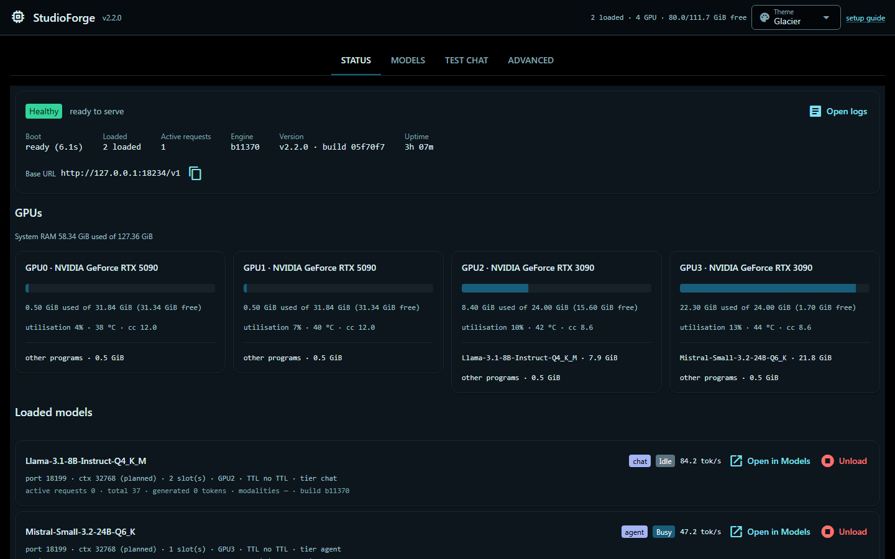<br><sub><b>Status.</b> Health, every GPU and what is on it, and the loaded models.</sub></td>
    <td width="50%">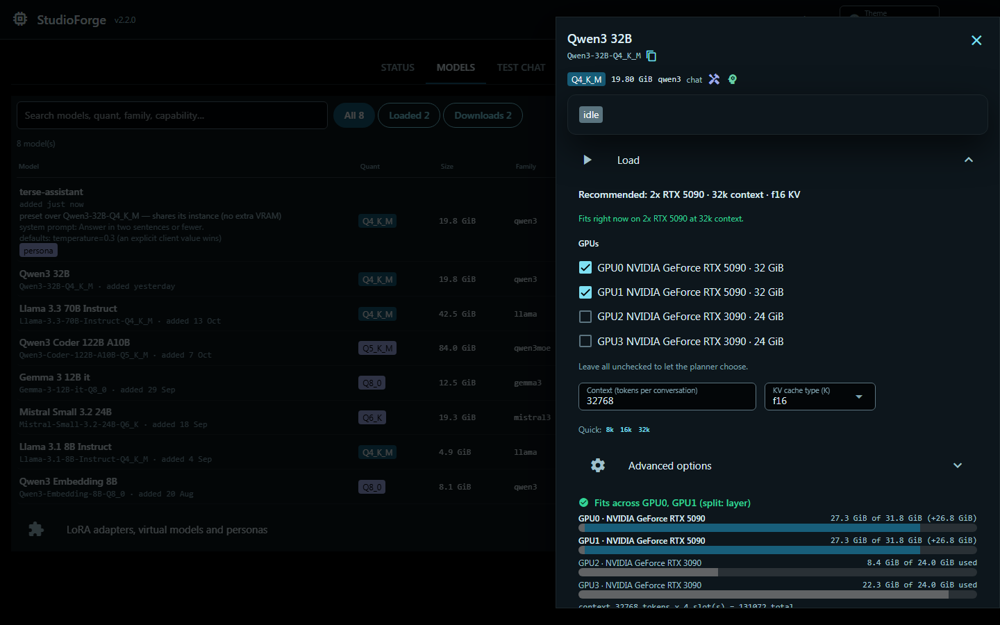<br><sub><b>Models.</b> The planner's recommended load is pre-filled and the fit is drawn per GPU before you press Load.</sub></td>
  </tr>
</table>

## Contents

[What it does](#what-it-does) · [Quick start](#quick-start) · [Architecture](#architecture) · [A request, step by step](#a-request-step-by-step) · [Loading and placement](#loading-and-placement) · [GPU leases](#gpu-leases) · [Priority tiers](#priority-tiers) · [Tenants](#tenants-sharing-the-gpus) · [Keys and auth](#keys-and-auth) · [The panel](#the-panel) · [sfctl](#the-companion-sfctl) · [MCP](#mcp-tools) · [Configuration](#configuration) · [What is new in 2.3](#what-is-new-in-23) · [Documentation](#documentation)

## What it does

- **GPU only, and honest about it.** A model runs entirely in VRAM or is refused with the numbers and a fix. There is no silent spill to CPU.
- **Plans multi-GPU placement.** It picks the cards, context size, KV cache type and parallel slots, and shows the fit before you load.
- **Loads on demand.** Name a model in a request and it loads. Idle models unload on a timer; pinned ones stay.
- **Shares the cards.** Other GPU programs take a lease first, and StudioForge plans around it.
- **Scoped keys and accounts.** `read`, `inference` and `admin` keys, an owner login, and an audit log.
- **Manageable by an agent.** 39 MCP tools (29 on the server, 10 on a separate watchdog) cover load, pin, download, benchmark, lease and recover.
- **Private.** No telemetry. The only outbound requests are the ones you ask for: Hugging Face for search and downloads, GitHub for llama.cpp builds and updates.

It does no inference of its own and never offloads to CPU. It speaks the OpenAI API, the Anthropic Messages API and the LM Studio native API; [`docs/API.md`](docs/API.md) lists which endpoints are complete, partial or refused.

## Quick start

You need an NVIDIA driver (580 series or newer on Windows), [`uv`](https://docs.astral.sh/uv/) and
`git`. On Linux the pinned llama.cpp engine is built from source on the first start, so you also need
`cmake`, a compiler and a CUDA toolkit that matches your driver; the container install avoids that
([`docs/INSTALL.md`](docs/INSTALL.md)).

**1. Install and start** (Linux shell; the Windows commands are in
[`docs/INSTALL.md`](docs/INSTALL.md#windows)):

```bash
git clone https://github.com/LaserLloyd/StudioForge.git
cd StudioForge
uv venv --python 3.12 .venv
uv pip install --python .venv/bin/python -e .
.venv/bin/studioforge serve --open
```

The first start downloads (Windows) or builds (Linux) the pinned engine, then opens the panel at
<http://127.0.0.1:8080>. The panel's setup guide covers the owner account, hardware, model library
and a starter model.

**2. Get a model.** In a second terminal:

```bash
.venv/bin/studioforge get unsloth/Qwen3-8B-GGUF
.venv/bin/studioforge ls
```

`get` picks the quant that fits your cards. `ls` prints the model ids you can use. If you already
have a LM Studio library, the setup guide's **Detect LM Studio library** step indexes it in place.

**3. Send a request.** Naming a model that is not loaded loads it first:

```bash
curl http://127.0.0.1:1234/v1/chat/completions \
  -H "Content-Type: application/json" \
  -d '{"model": "<id from studioforge ls>", "messages": [{"role": "user", "content": "hello"}]}'
```

Any OpenAI client works the same way: set the base URL to `http://127.0.0.1:1234/v1`.

All three services bind `127.0.0.1` until you say otherwise, and a server with no keys is open to
the machine it runs on. To use it from another machine, run `studioforge setup` (it creates the owner
account and can turn on HTTPS), then give each client its own key:

```bash
.venv/bin/studioforge keys create --name my-agent --scope inference
```

The token is printed once. Clients send it as `Authorization: Bearer <key>` or `x-api-key: <key>`.

## Architecture

One gateway process serves four surfaces and starts one `llama-server` per loaded model on an internal port. A separate watchdog process shares no code path with the gateway, so it can still diagnose and restart it when the gateway is wedged.

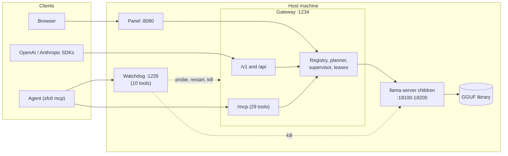

The gateway holds the registry (SQLite), the VRAM planner, the supervisor and the lease book. A crashed model takes down one `llama-server`, not the gateway. The tray (Windows) restarts the server on a crash. Components, the watchdog's four health states and the version scheme are in [`docs/ARCHITECTURE.md`](docs/ARCHITECTURE.md).

## A request, step by step

This is what happens to `POST /v1/chat/completions`.

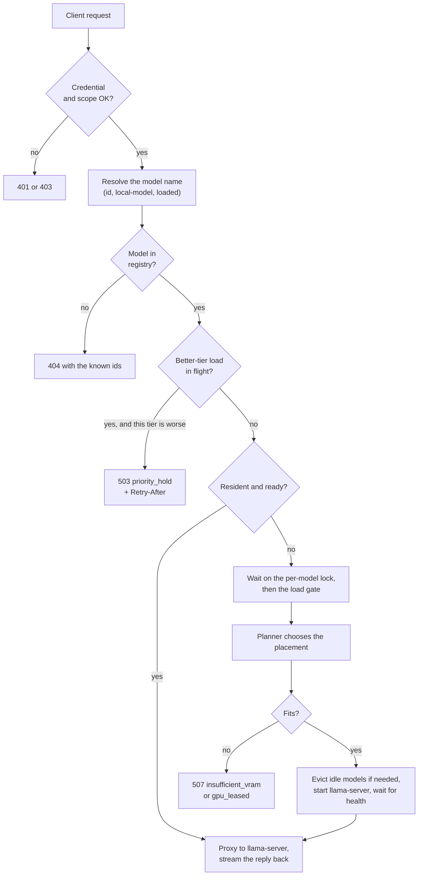

A burst of requests for a cold model starts exactly one `llama-server`; the rest wait on the same
lock and are served once it is up. The model name can also be `local-model` (or `default`, `auto`,
`current`), which means `models.default_model`, or `loaded`, which means the largest resident model
that can serve this kind of request. A request body may carry `priority` (1, 2 or 3) and `ttl`
(idle seconds); [`docs/API.md`](docs/API.md) has the contract.

## Loading and placement

The planner decides whether a model fits and where. It never decides to use the CPU. Every load
records predicted against actual VRAM, and the next plan of the same shape is sized from what was
measured.

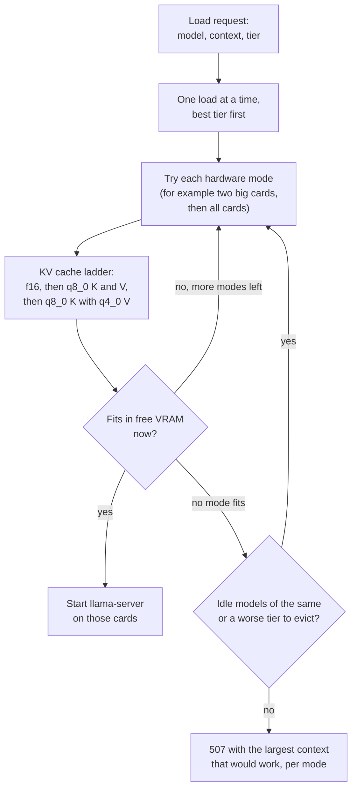

Two ways to ask:

- **Plain load** (`studioforge load`, `POST /api/models/{id}/load`) walks the context down a ladder
  (262144, 131072, 98304, 65536, and so on down to 512) until the model fits.
- **Load at a context** (`sfctl models load-recommended`, MCP `load_recommended`) is strict. The
  context you name is the request: you get exactly that window per slot or a refusal that says what
  would fit instead. Agents use this when a transcript needs a specific window.

To see a plan without loading anything, use `sfctl models plan <model>` or the drawer in the panel.
`sfctl models options <model>` prints the best context and slot count per hardware mode.

## GPU leases

A lease is an exclusive claim on whole CUDA devices. While it stands, the planner treats those cards
as absent: a JIT load goes elsewhere, or is refused with `507 gpu_leased` naming the lease. This is
how an image server or a speech server keeps its card.

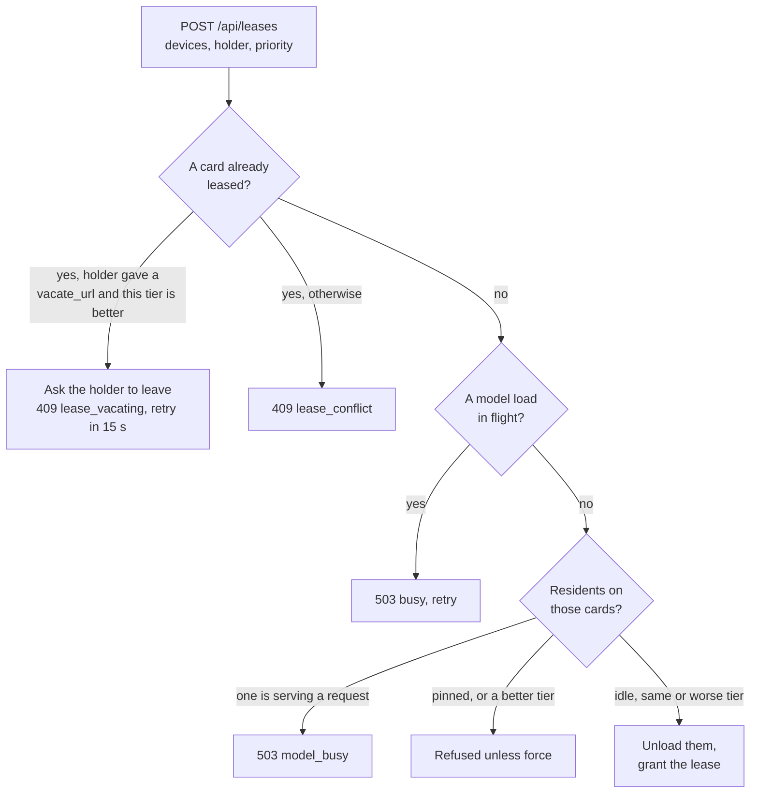

Once granted, a lease lives until it is released or goes idle:

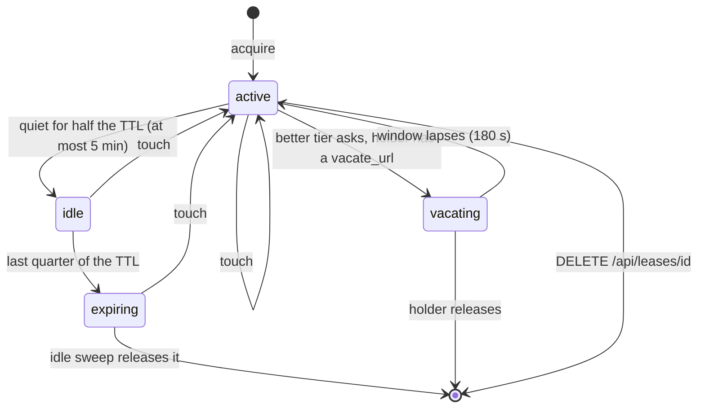

- The idle TTL defaults to 3600 s (`null` means until released). A holder must `touch` a long job
  because StudioForge cannot see what the holder is doing.
- A lease is never taken away. A better tier can only ask the holder to leave, once, and the holder
  has `leases.vacate_timeout_s` (180 s) to release.
- Leases survive a StudioForge restart with their clocks, so a holder that did everything right keeps
  its card.

## Priority tiers

Every load carries a tier, saved per model in `settings.priority` so it survives a restart. The default
is background.

| Tier | Meant for | Idle timer | May evict, idle only |
| --- | --- | --- | --- |
| 1 | The model a person is chatting with | 900 s | idle models of tier 1, 2 or 3 |
| 2 | A model an agent was sent off to use | 900 s | idle models of tier 2 or 3 |
| 3 | Background work, and any load that did not say | 600 s | idle models of tier 3 |

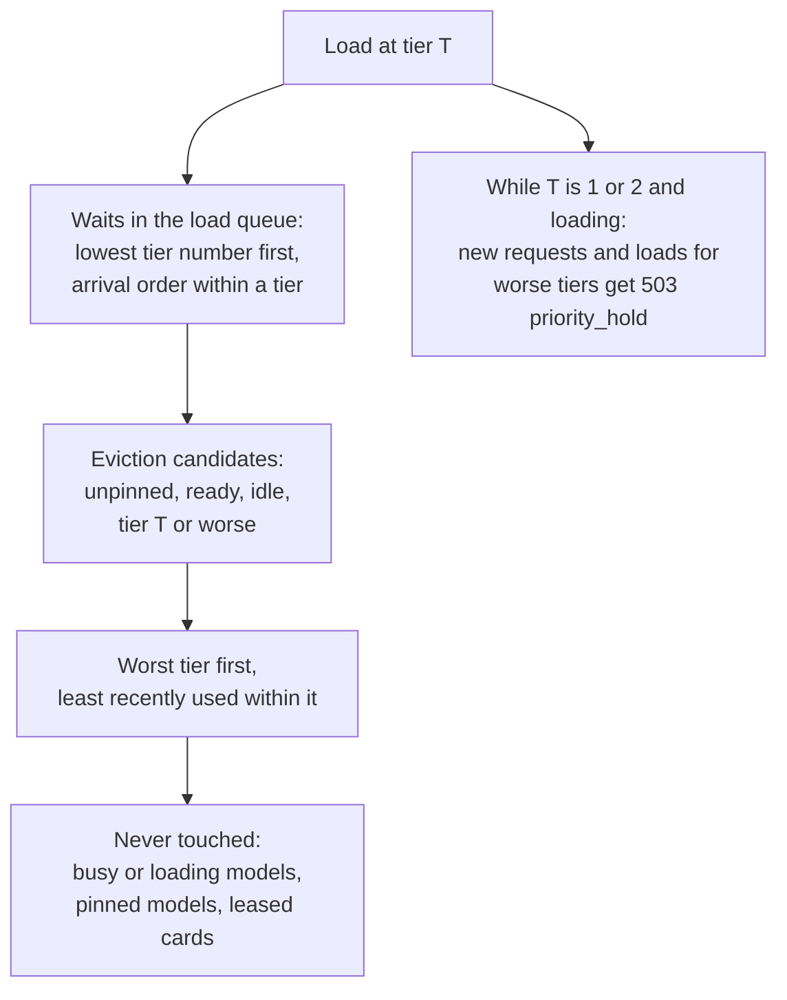

A tier 1 or 2 load also plans as if every idle model of a strictly worse tier were already gone, so it
gets the placement an empty box would give it; those models are moved off its cards and reload
afterwards where they fit. An equal-tier model is evicted only when the fit demands it.

A `priority_hold` and a lease `409` mean different things. `503 priority_hold` (with `Retry-After`)
means wait for a load to finish and retry. A `409 lease_conflict` against a standing lease is
terminal for that request: the card is not coming back soon. The idle timers are
`models.ttl_by_priority`; a pin or a per-model `ttl_s` outranks them.

## Tenants: sharing the GPUs

A tenant is any other GPU program on the box: an image gateway, a speech server, a benchmark harness.
The VRAM Tenant Protocol (`vt.1`) is a few HTTP calls. A tenant takes a lease before it allocates,
announces itself so the panel can show its health, and steps aside when asked. StudioForge never
starts or stops a tenant.

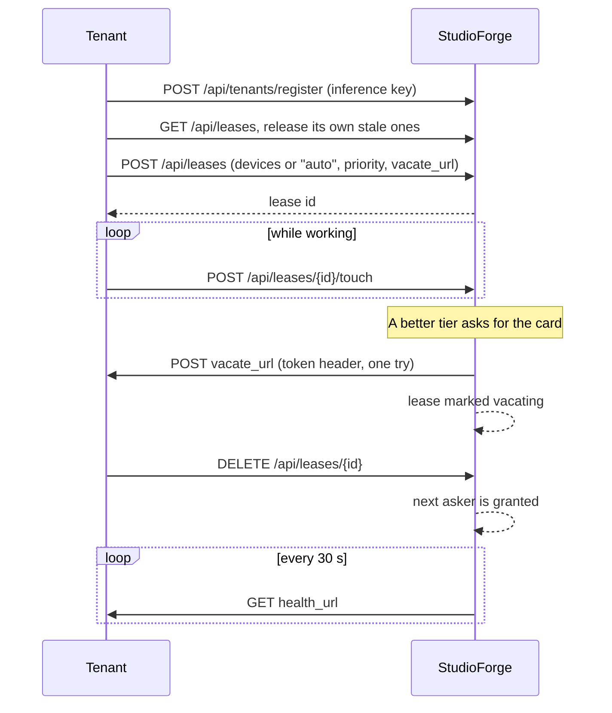

Tenants hold `inference` keys, never `admin`. Each lease is bound to the key that created it, so one
tenant cannot renew or release another's. Automatic placement (`devices: "auto"`) picks one card,
fewest evictions first, and never triggers a vacate. The `packages/studioforge-tenant` SDK is a small
HTTP client for all of this. Full protocol: [`docs/TENANTS.md`](docs/TENANTS.md).

## Keys and auth

Every credential resolves to one of three scopes. A scope is enforced whenever a key is presented,
even on an install that does not require one.

| Scope | May |
| --- | --- |
| `read` | Look: `GET` routes, `/v1/models`, MCP read tools |
| `inference` | Everything in `read`, plus chat and completions, load, unload and test a model, and the tenant side of leases |
| `admin` | Change the box: config, engines, updates, downloads, delete, pin, keys, accounts, audit |

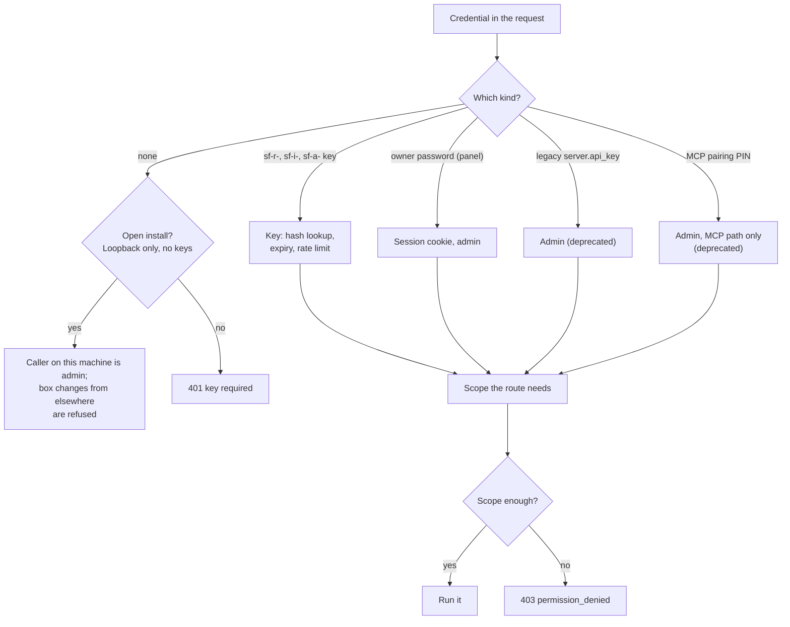

- Keys look like `sf-<r|i|a>-<43 characters>`. Only a SHA-256 is stored, and the token is shown once.
- A server that would listen on the network refuses to start until an owner account or an admin key
  exists. Once one does, every request needs a credential except the `/health` liveness probe.
- Three wrong credentials from an address start a lockout that doubles up to five minutes.
- Everything an admin does goes to an append-only audit log.

[`docs/SECURITY.md`](docs/SECURITY.md) has the full model: TLS, CORS, rate limits, secrets at rest and
a hardening checklist.

## The panel

`http://127.0.0.1:8080` has four tabs. **Status** shows health, every GPU and the loaded models.
**Models** is the library, with a details drawer that pre-fills the planner's recommended load and
draws the per-GPU fit before you press Load. **Test Chat** streams a reply with time to first token
and tokens per second, and copies the request as `curl`. **Advanced** holds the rest: serving and
network, accounts and keys, engines, watchdog, integrations, logs, config and diagnostics.
[`docs/panel.md`](docs/panel.md) maps every control and has more screenshots.

## The companion: `sfctl`

[`packages/studioforge-companion`](packages/studioforge-companion/README.md) installs on any machine with no CUDA and no server code. It is the remote control for a StudioForge host.

```bash
uv build --wheel -o dist                                              # in packages/studioforge-companion
uv tool install ./dist/studioforge_companion-<version>-py3-none-any.whl
sfctl servers add rig http://<studioforge-host>:1234 --api-key <key> --use
sfctl status
```

`sfctl status` shows VRAM per GPU, loaded models, standing leases and the engine. `sfctl models` loads, unloads, pins and plans; `sfctl models load-recommended <model> --ctx N` loads at exactly that context or refuses. `sfctl search` and `sfctl models repo` find a GGUF and give a fit verdict before you download. `sfctl leases` and `sfctl tenants` show the lease book and the other GPU programs. `sfctl recover` talks to the watchdog when the server is wedged. Exit code 4 means the server is unreachable and 5 means the key was refused.

## MCP tools

`/mcp` on the gateway offers 29 management tools; the watchdog on `:1235` offers 10 recovery tools.
`sfctl mcp` merges them into one stdio server, so an agent keeps `restart_server` even when the
gateway is down. There are no inference tools: chat goes through `/v1`. Each tool needs a scope:
read-only tools need `read`, tools that load or lease need `inference`, and anything destructive, or
that changes settings, needs `admin`. Destructive tools also require `confirm=true`, and a tool the
policy table does not know needs `admin`.

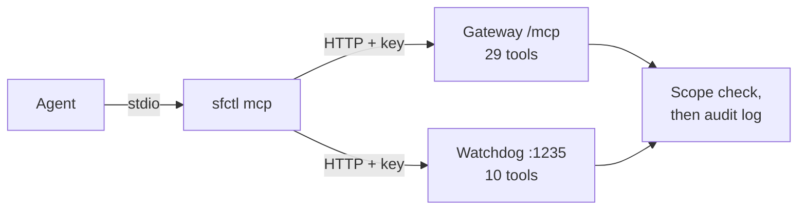

Register it with your agent:

```bash
openclaw mcp add studioforge --command sfctl --arg mcp
```

Clients that read a generic `mcpServers` map want `{"studioforge": {"command": "sfctl", "args": ["mcp"]}}`.
Step-by-step setup, the agent loop and the whole-rig page are in
[`docs/OPENCLAW-SETUP.md`](docs/OPENCLAW-SETUP.md), [`docs/OPENCLAW.md`](docs/OPENCLAW.md) and
[`docs/OPENCLAW-RIG.md`](docs/OPENCLAW-RIG.md); [`docs/CONNECT.md`](docs/CONNECT.md) shows the other
ways in.

## Configuration

Settings live in `config.yaml` in the data directory. Edit them in the panel (Advanced), with `sfctl config set key=value`, or by hand. [`config.example.yaml`](config.example.yaml) lists every key with its default, and `studioforge config check` validates the file exactly as `serve` will load it. The keys you will touch first are `server.host` (a non-loopback bind needs an owner account or an admin key), `server.tls.mode`, `models.dir`, `models.default_model` and `models.ttl_by_priority`. [`docs/CONFIGURATION.md`](docs/CONFIGURATION.md) has the table.

**Data directory.** Everything the app writes (`config.yaml`, `registry.sqlite3`, `engines/`, `logs/`, `downloads/`) lives in one directory: `SF_DATA_DIR` if set, else the folder of a `--config` file, else `<repo>/data` in a checkout, else the platform data directory. One directory serves one running instance. See [`docs/INSTALL.md`](docs/INSTALL.md#data-directory).

**Accounts and lockout recovery.** The panel signs in with an owner account; programs use API keys. Manage both with `studioforge users list|add|passwd|delete` and `studioforge keys list|create|revoke`. Locked out with no working CLI? Create a file named `RESET_LOGIN` in the data directory and start the server. It is read once at start, deleted before it is applied, and cannot be triggered over the network. Commands for Windows, Linux and Docker: [`docs/ACCOUNTS.md`](docs/ACCOUNTS.md).

**Windows launchers.** [`launchers/`](launchers/) has double-click files: `Start StudioForge.bat`, `StudioForge Tray.bat`, `Open StudioForge GUI.bat`, `StudioForge Autostart.bat` and `Update StudioForge.bat`. To keep data outside the checkout, copy `launchers\local-env.example.bat` to the repo root as `local-env.bat` and set `SF_DATA_DIR`. ([What each does](docs/INSTALL.md#windows-launchers).)

## What is new in 2.3

2.3.0 is a security release. The authentication changes:

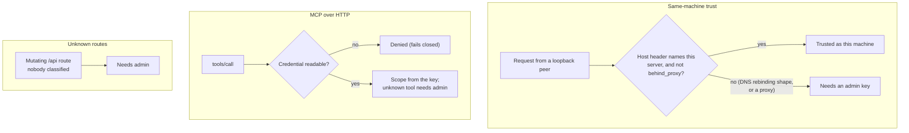

- **Loopback trust needs a loopback `Host`.** A page on another site whose name was re-pointed at
  `127.0.0.1` is no longer "this machine". Accepted hosts are loopback names, the hosts of
  `server.cors_origins`, and `server.allowed_hosts`. New `server.behind_proxy` turns the shortcut off
  entirely for proxied installs, and `studioforge doctor` warns about it.
- **MCP fails closed.** An HTTP tool call whose headers cannot be read is denied, not treated as the
  local process. `PATCH /api/config` refuses a non-loopback bind without an admin credential.
- **Unknown mutating routes need `admin`**, so a route added later without a scope fails safe.
  `GET /logout` no longer signs you out.
- **Hardened TLS and secrets.** Self-signed certificates cover only loopback and your bind hosts, are
  renewed only when needed, and are written under a lock. The legacy `server.api_key` has a
  16-character minimum, and support bundles mask more of the paths and peers they contain.
- **Licence: MIT-0**, author Laser Lloyd.
- **Also fixed:** gpt-oss multi-turn chats no longer fail with HTTP 500 (D82), and interleaved
  streamed tool calls are no longer dropped.

2.2.0 reorganised the panel into four tabs, 2.1.0 added `studioforge users` and `RESET_LOGIN`, and
2.0.0 introduced scoped keys, secure-by-default binds and backend-aware engines. Every release and the
decisions it carries are in [`CHANGELOG.md`](CHANGELOG.md).

## Documentation

- [`docs/INSTALL.md`](docs/INSTALL.md): Windows, Linux and Docker installs, upgrade, ports, launchers
- [`docs/SETUP.md`](docs/SETUP.md): the first-run guide, page by page; GPUs, engine, network, downloads
- [`docs/ARCHITECTURE.md`](docs/ARCHITECTURE.md): components, request flow, watchdog states, versions
- [`docs/CONFIGURATION.md`](docs/CONFIGURATION.md): the keys you will change
- [`docs/API.md`](docs/API.md) and [`docs/CONNECT.md`](docs/CONNECT.md): endpoints and how to connect a client or an agent
- [`docs/CLI.md`](docs/CLI.md): every `studioforge` command (generated)
- [`docs/SECURITY.md`](docs/SECURITY.md), [`SECURITY.md`](SECURITY.md) and [`docs/ACCOUNTS.md`](docs/ACCOUNTS.md): scopes, TLS, audit, reporting, logins
- [`docs/TENANTS.md`](docs/TENANTS.md): the VRAM Tenant Protocol
- [`docs/panel.md`](docs/panel.md): every control in the panel
- [`docs/ENGINES.md`](docs/ENGINES.md), [`docs/ENGINE-FEATURES.md`](docs/ENGINE-FEATURES.md): llama.cpp builds, hardware detection, features
- [`docs/CATALOG.md`](docs/CATALOG.md), [`docs/BENCHMARKING.md`](docs/BENCHMARKING.md): the model catalog and the benchmarking playbook
- [`docs/OPENCLAW-SETUP.md`](docs/OPENCLAW-SETUP.md), [`docs/OPENCLAW.md`](docs/OPENCLAW.md), [`docs/OPENCLAW-RIG.md`](docs/OPENCLAW-RIG.md), [`docs/OPENCLAW-LONG-CONTEXT.md`](docs/OPENCLAW-LONG-CONTEXT.md): running it with an MCP agent
- [`docs/RUNBOOK.md`](docs/RUNBOOK.md): what `/health` means and what to do when it is wrong
- [`docs/LIMITATIONS.md`](docs/LIMITATIONS.md), [`docs/COMPARISON.md`](docs/COMPARISON.md): known limits; how it compares
- [`docs/DEVELOPMENT.md`](docs/DEVELOPMENT.md), [`CONTRIBUTING.md`](CONTRIBUTING.md), [`docs/RELEASING.md`](docs/RELEASING.md): working on the code
- [`DECISIONS.md`](DECISIONS.md): why each rule exists, with the measurement; [`CHANGELOG.md`](CHANGELOG.md): releases

There is also [a write-up](https://www.laserlloyd.com/projects/studioforge-gpu-only-llm-server/) on LaserLloyd.com.

## Related projects

Same author, built to share one GPU box with StudioForge: [SpeechForge](https://github.com/LaserLloyd/SpeechForge) (GPU speech server) and [DisPatch](https://github.com/LaserLloyd/DisPatch_Chat) (a self-hosted chat app). SpeechForge takes a StudioForge lease before it uses a card. The panel theme is [ThemeForge](https://github.com/LaserLloyd/ThemeForge).

## Contact

Built and maintained by Laser Lloyd, [LaserLloyd.com](https://laserlloyd.com).

- Bugs, questions and ideas: [open an issue](https://github.com/LaserLloyd/StudioForge/issues)
- Email: [Lloyd@LaserLloyd.com](mailto:Lloyd@LaserLloyd.com) <!-- scrub-ok: the maintainer's published contact address, deliberate -->
- More projects: [github.com/LaserLloyd](https://github.com/LaserLloyd)

## License

**MIT-0** (MIT No Attribution), copyright 2026 Laser Lloyd. See [`LICENSE`](LICENSE). Use it, fork it,
ship it; no attribution is required.

The dependencies are permissive too (MIT, BSD, Apache-2.0) with one exception: `pystray`, which draws
the Windows tray icon, is LGPL-3.0. It is an unmodified dependency installed by pip and imported at
runtime, which is the arrangement the LGPL is written for. If you redistribute a frozen build that
embeds it, the relinking obligation is yours.
