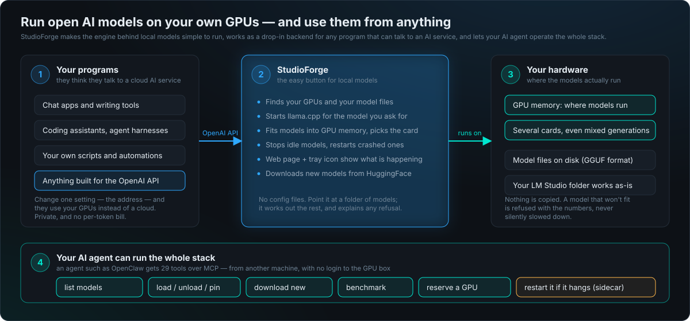
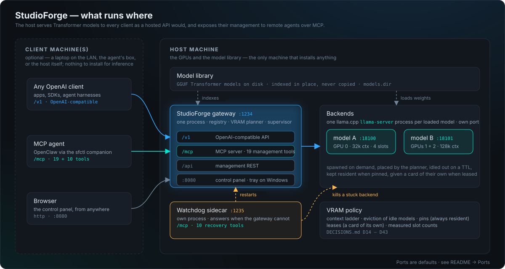
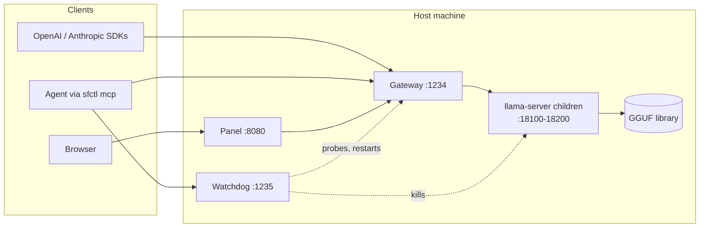
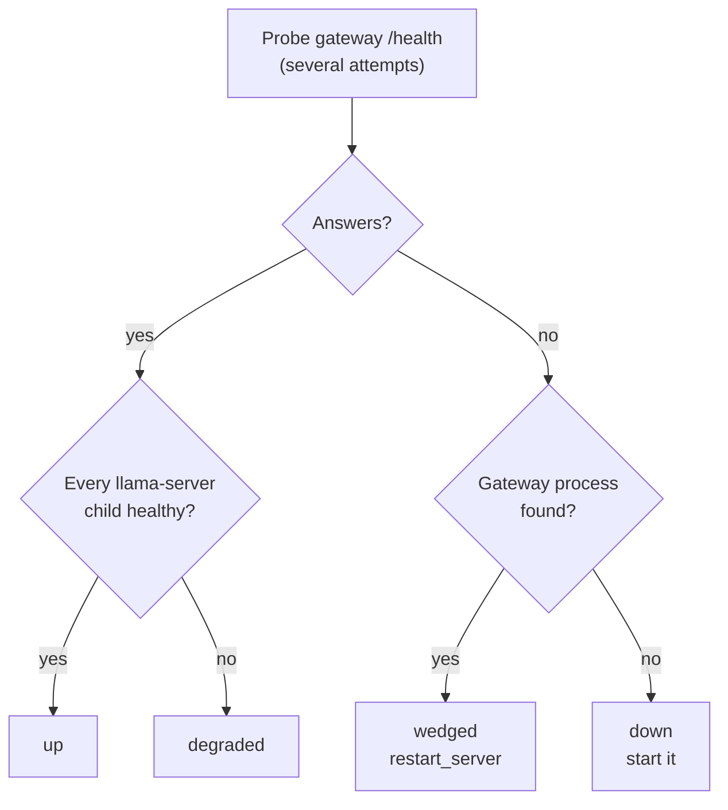

# Architecture

What runs where, how one request travels, and how the pieces recover when something wedges. The
[README](../README.md#architecture) has the short version with diagrams; this page has the detail the
README leaves out. Every number and rule here is also a numbered decision in
[`../DECISIONS.md`](../DECISIONS.md), with the measurement behind it.

## In plain English

Three ideas: your programs keep talking to the API they already know and just get a new address;
StudioForge runs the engine behind local models for you — finding GPUs and model files, fitting
models into memory, restarting what crashes — so you never write a config file; and your AI agent
can operate all of it from another machine. The rest of this section is the technical version.

## Technical brief

**Why it exists.** Running Transformer models on your own GPUs leaves you without the operational
layer a hosted API takes for granted: an endpoint every client already speaks, capacity planning
across the cards, recovery when a process wedges, and — above all — *remote* management, so the
machine running your agent is not the machine running your models. StudioForge is that layer. It
puts llama.cpp backends (one `llama-server` process per loaded GGUF model) behind the OpenAI API,
and puts their **management** — load, unload, pin, benchmark, lease GPUs, recover — behind
[MCP](https://modelcontextprotocol.io), so an agent such as OpenClaw can operate the GPU host from
another machine with no shell on it.

**What it is not.** It does no inference of its own, it never offloads to CPU, and it never phones
home: a model runs entirely in VRAM or is refused with the numbers, and the only outbound requests
are the ones you ask for.

**Sharing the GPUs.** Other programs on the same box -- an image server, a speech server -- take
GPU **leases** from StudioForge before they allocate, and StudioForge plans around them. The
contract they follow, the registry that lists them with live health, and the SDK they adopt are
the [VRAM Tenant Protocol](TENANTS.md). StudioForge never starts or stops one of them.

## Components

| Component | Runs on | Role |
| --- | --- | --- |
| **Host machine** | The box with the NVIDIA GPUs and the GGUF library | Runs everything below. The only machine that installs anything. |
| **Gateway** (`:1234`, one process) | Host | Four surfaces: `/v1` the OpenAI-compatible API; `/mcp` an MCP server with 29 management tools; `/api` the management REST; `:8080` the control panel (plus a system tray on Windows). Inside: the registry, the VRAM planner and the supervisor. |
| **Backends** — `llama-server` | Host, one process per loaded model, each on its own internal port | [llama.cpp](https://github.com/ggml-org/llama.cpp)'s server, pinned to a tested build and fetched automatically. Spawned on demand, placed by the planner, idled out on a TTL, kept resident when pinned, given a card of their own when leased. A crash takes down one model, never the gateway. |
| **Model library** | Host, on disk (`models.dir`) | Your GGUF Transformer models, indexed in place — the same folder LM Studio uses; nothing is copied or moved. |
| **Watchdog sidecar** (`:1235`) | Host, a separate process | Its **own MCP server** with 10 recovery tools — restart the gateway, kill a stuck backend, reclaim VRAM, tail logs — reachable when the gateway is wedged, because it is not the gateway. |
| **VRAM policy** | Host, inside the planner | The context ladder, eviction of idle models, pins, leases and measured slot counts — every rule with its measurement in [`DECISIONS.md`](../DECISIONS.md) D14–D43. |
| **Client machine(s)** | Anything on the LAN or tailnet — a laptop, a NAS, the agent's box; or the host itself | Nothing to install for inference: any OpenAI client points at `:1234/v1`. For management, the `sfctl` companion (see its [README](../packages/studioforge-companion/README.md)) (no GPU, no CUDA) bridges both MCP servers into one toolset. |

The same layout as a diagram:

## How a request flows

1. A client `POST`s to `/v1/chat/completions` naming a model — or `local-model`, which resolves to
   `models.default_model` (so do `default`/`auto`/`current`), or `loaded`, which resolves instead
   to the largest model already resident that can serve this route's kind of request (a chat model,
   here — `/v1/embeddings` and `/v1/rerank` resolve `loaded` against their own kind). It is a live
   read of the supervisor, not the static default. Nothing of that kind resident is a 404 naming
   the remedy; one of that kind still loading is a 503 with a `Retry-After`. See [`OPENCLAW.md`](OPENCLAW.md#zero-config-inference-a-default-model)
   for the full contract.
2. The gateway looks the model up in the registry. If a backend is already serving it, the request
   is proxied straight through, streaming intact.
3. Otherwise the VRAM planner chooses a placement: which GPUs, what context (walking a ladder down
   from `models.target_ctx` until it fits), which KV cache type, how many parallel slots. It may
   evict *idle* models when policy allows; it never touches a pinned model, a leased card, or a
   model mid-request.
4. The supervisor spawns a `llama-server` on an internal port, waits for it to pass health, and the
   request proceeds. The backend idles out after its TTL unless pinned.
5. Everything else — loading ahead of time, pinning, leasing a card, benchmarking, downloading —
   happens over `/mcp` or `/api`; if the gateway itself stops answering, the sidecar's tools on
   `:1235` restart it.

## Why it is worth running

- **It tells the truth about VRAM.** A model runs entirely on GPU or it is refused with the
  numbers and a fix — never silently spilled to CPU at a twentieth of the speed.
- **Multi-GPU is planned, not guessed.** Placement across mixed cards, context sized to what
  fits, measured slot counts, pins for models that must always be warm, and leases that give a
  model a card of its own ([`DECISIONS.md`](../DECISIONS.md) D14–D43, each with its measurement).
- **The chat model comes first.** A load can say what it is — `priority: 1` the model a person
  is chatting with, `2` a dispatched agent, `3` (or nothing) background. A chat load takes the
  fastest placement (idle background models are moved off its cards and reloaded afterwards
  where they fit), jumps the load queue, and holds background traffic off while it loads;
  background can never displace it. The tier is saved per model (`settings.priority`), so it
  survives a restart instead of quietly falling back to background; a single request can state
  its own tier in the body of a chat completion; and traffic held off while a better-tier load
  runs is refused with the distinct code `priority_hold` and a `Retry-After` worth honouring
  ([`DECISIONS.md`](../DECISIONS.md) D46, D48).
- **Drop-in for LM Studio.** Same port, same `/v1/models` behaviour, same library on disk —
  switching a client is a host change.
- **Built for agents.** 39 MCP tools with a catalog that hands an agent the exact load
  arguments, a benchmarking playbook it can follow, and recovery tools that survive a wedged server.
- **One call answers "do I even need to load anything?"** `check_loaded_model(min_params="20b",
  vision=true)` asks whether what is *already* resident clears the bar — size, and capabilities
  like vision, tools, thinking or uncensored — and a yes comes back with the model id to send the
  work to, so an agent skips a 40-second load or a cloud fallback it did not need. Nothing the
  server cannot prove is allowed to pass ([`DECISIONS.md`](../DECISIONS.md) D52).
- **Recovers.** A crashed model restarts with backoff, the Windows tray restarts a crashed server, the
  watchdog still answers when the gateway does not, and VRAM cannot outlive its owner process.
- **Private by construction.** Nothing leaves the box unless you ask for it.

## Watchdog states

The watchdog is a separate process that shares no code path with the gateway, so it still answers
when the gateway does not. It probes the gateway's `/health`, then looks for the gateway process, and
reports one of four states:

A `degraded` result also covers a gateway that answers while no matching process can be found
(a container, another user, a proxy): inference works, but `restart_server` and `kill_model` cannot
reach anything. How many failed probes make a gateway `wedged` is `watchdog.wedged_after_failures`
(default 3).

## Versions and builds

StudioForge uses semantic versioning since 2.0.0. The version lives in
`src/studioforge/__init__.py` — `2.3.0` — and is what `GET /api/version`, `GET /health`, the MCP
`server_status` tool and `sfctl status` report; all three `pyproject.toml` files (the app,
`packages/studioforge-companion` for `sfctl`, and `packages/studioforge-tenant`) carry the same string,
the companion ships from the same release and carries the same version, and release tags are
`v2.3.0`. Releases before 2.0.0 were calendar-versioned (`1.26-08-23` style); the updater reads both
schemes, so a 1.x install sees 2.0.0 as the update it is. Check what a server is actually running with
`curl -s <host>/api/version`. A server running a commit past its release still reports that release,
but the `build` field beside `version` (on `/health`, `/api/version`, `/api/status`, `server_status`
and the "starting" log line) names the checkout itself: the short commit SHA, `-dirty`
when tracked files carry uncommitted changes, or `unknown` from a wheel or without git. To branch on
behaviour, **feature-gate on `GET /api/capabilities` instead**: its `implemented` block lists every decision
number the build includes (`"D61" in implemented.decisions`) and named behaviours
(`"plan_recommended" in implemented.features`), and is never behind the code (`DECISIONS.md` D64).

## Project layout

| Path | What lives there |
| --- | --- |
| `src/studioforge/` | The app: `api/` (gateway and management routes), `core/` (registry, VRAM planner, supervisor, engine, leases, tenants, benchmarks, downloader), `gui/`, `mcp/` (29 tools), `tray/`, `watchdog/` (10 tools), `migrations/` |
| `packages/studioforge-companion/` | `sfctl` and the `sfctl mcp` bridge |
| `packages/studioforge-tenant/` | The tenant SDK: lease a card, register, honour a vacate request ([`TENANTS.md`](TENANTS.md)) |
| `launchers/` | Windows double-click launchers |
| `deploy/` | Linux systemd user units, compose files, Windows installer |
| `docs/` | Setup, OpenClaw, the catalog, benchmarking, the runbook, limitations |
| `tests/unit/` | The suite CI runs (no GPU, no network); `tests/contract/` needs real engines and weights, opt-in |
| `DECISIONS.md` | The architectural decision log, D1 onward: the *why* behind every rule |
| `config.example.yaml` | Every config key with its shipped default, annotated |
