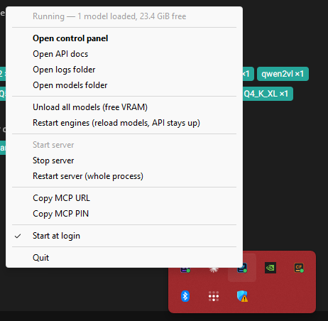

# Install and run

How to put StudioForge on a machine, keep it up to date, and find your way around the files it
writes. For the five-minute version see the [README quick start](../README.md#quick-start). Once it
is running, [`SETUP.md`](SETUP.md) walks through the first-run guide page by page.

On this page: [Windows](#windows) · [Linux](#linux) · [macOS](#macos) · [Upgrade and uninstall](#upgrade-and-uninstall) · [First run](#first-run-any-platform) · [Ports](#ports) · [Data directory](#data-directory) · [Windows launchers](#windows-launchers)


Pick your platform below. Methods are listed simplest first, and each block runs top to bottom on a
fresh machine. StudioForge serves models from GPU memory only. NVIDIA (CUDA) is the tested path; the
AMD (ROCm) and Vulkan images build and boot but have not been run on real AMD or Intel hardware.
With no usable GPU the server still starts and reports `can_serve=false`.

**Ports:** `1234` gateway (`/v1`, `/api`, `/mcp`, `/health`), `8080` control panel, `1235` watchdog
sidecar. All three bind `127.0.0.1` unless you change it (see [Ports](#ports)). LM Studio also uses
`1234`: quit it first. In the Docker methods these are the container ports; change the host side with
`SF_GATEWAY_PORT`, `SF_PANEL_PORT` and `SF_WATCHDOG_PORT` in `.env`.

## Windows

You need an NVIDIA driver from the 580 series or newer for the CUDA 13 engine builds (no CUDA toolkit
needed: the prebuilt engine ships its runtime).

### 1. Git + uv, run from a clone (simplest)

Choose this for one Windows PC with an NVIDIA GPU. It uses the prebuilt llama.cpp engine, and
`launchers\` adds a tray icon and start-at-login.

```powershell
winget install --id Git.Git -e
winget install --id astral-sh.uv -e
```

Close PowerShell and open a new window so `git` and `uv` are on `PATH`, then:

```powershell
git clone https://github.com/LaserLloyd/StudioForge.git
cd StudioForge
uv venv --python 3.12 .venv
uv pip install --python .venv\Scripts\python.exe -e .
.venv\Scripts\python.exe -m studioforge serve --open
```

The first start downloads the pinned llama.cpp engine and checks its checksum. `serve --open` stays in
the foreground and opens the control panel at <http://127.0.0.1:8080>. To check it, open a second
PowerShell window:

```powershell
curl.exe -s http://127.0.0.1:1234/health
```

The panel's setup guide creates the owner account in its first step. To do that from the terminal instead
(pick your own password, 10 or more characters; this also downloads and smoke-tests the llama.cpp engine),
run this before the first `serve`:

```powershell
$env:SF_OWNER_PASSWORD = "choose-a-password"
.venv\Scripts\python.exe -m studioforge setup --non-interactive --username owner --password-env SF_OWNER_PASSWORD --skip-model --skip-chat --no-start
```

The options of every command are in [`docs/CLI.md`](CLI.md), and [`docs/SETUP.md`](SETUP.md) walks
through the same first run.

A later `studioforge engine --update` installs the newest llama.cpp build your driver can run and
smoke-tests it before activating. The full smoke test micro-loads one small GGUF from your library;
with an empty library it runs `llama-server --version` and `--list-devices` only, records
`binary-only (no model available)` and still activates, and the next engine check with a model
present runs the real micro-load. Prefer double-clicking? `launchers\Update StudioForge.bat`
does the venv, install and engine steps,
`launchers\Start StudioForge.bat` starts the server, and `launchers\StudioForge Tray.bat` runs it from
the notification area (see [Windows launchers](#windows-launchers)).

| Pros | Cons |
| --- | --- |
| Fewest steps, no container layer | You update Python packages and the engine yourself |
| Prebuilt engine, nothing to compile | Windows only; data lives in `data\` inside the clone unless you set `SF_DATA_DIR` |
| Tray, autostart and Update launchers included | Runs as your user, not isolated from the rest of the PC |

### 2. Docker Desktop

Choose this to keep StudioForge in a container with its data on a Docker volume. The container is
Linux, so the llama.cpp engine is compiled inside it on the first start (several minutes of CPU) and
the image that can do that is large (about 14 GB).

```powershell
winget install --id Docker.DockerDesktop -e
winget install --id Git.Git -e
```

Start Docker Desktop once and accept its first-run prompts (WSL 2 backend; the Windows NVIDIA driver
gives containers GPU access). Then, in a new PowerShell window:

```powershell
git clone https://github.com/LaserLloyd/StudioForge.git
cd StudioForge\deploy\compose
@"
SF_BACKEND=cuda-devel
SF_MODELS=C:/Users/you/models
SF_OWNER_PASSWORD=change-this-password
"@ | Set-Content .env
docker build --build-arg BACKEND=cuda --build-arg CUDA_FLAVOR=devel --build-arg VERSION=2.3.0 -t ghcr.io/laserlloyd/studioforge:2.3.0-cuda-devel ..\..
docker compose -f compose.yml -f compose.cuda.yml up -d
docker compose ps
curl.exe -s http://127.0.0.1:1234/health
```

Edit the `SF_MODELS` path (your GGUF folder) and `SF_OWNER_PASSWORD` (10 or more characters) before you
run it. Open <http://localhost:8080> and sign in as `owner` with that password; create one key per
client under **Advanced > Accounts & keys**, and point clients at `http://localhost:1234/v1`. Leave
`SF_OWNER_PASSWORD` out and the container generates one into `/data/owner-password.initial` on the
volume. Once the image is published to the registry, replace the `docker build` line with
`docker compose -f compose.yml -f compose.cuda.yml pull`. Do not add `--build` to `up` (see the Linux note below).

| Pros | Cons |
| --- | --- |
| Data on a named volume, read-only image, pre-migration snapshots | About 14 GB image; engine compiles on first start |
| Easy upgrade and rollback by tag | Needs Docker Desktop and its NVIDIA/WSL 2 GPU setup |
| Nothing installed on Windows besides Docker | No tray icon; Docker Desktop must be running |

## Linux

Ubuntu and Debian package names are shown; use your distribution's equivalents. NVIDIA is the tested
GPU path. On Linux the pinned llama.cpp engine for NVIDIA is **built from source on the first start**
(minutes of CPU, once per version), which needs `git`, `cmake`, a compiler and a CUDA toolkit whose
`nvcc` matches your driver ([download](https://developer.nvidia.com/cuda-downloads)). The container
method brings its own toolchain.
AMD (ROCm) and Vulkan are untested on hardware.

### 1. Installer script with a systemd user service (simplest)

Choose this for a Linux box you want StudioForge to run on at login, with no `sudo` after the
prerequisites. It installs `uv` if you lack it, makes a Python 3.12 environment under your home
directory, and writes and starts two systemd **user** units (gateway and watchdog).

```bash
sudo apt-get update && sudo apt-get install -y git curl ca-certificates cmake build-essential
git clone https://github.com/LaserLloyd/StudioForge.git
cd StudioForge
deploy/linux/install.sh --from .
export PATH="$HOME/.local/bin:$PATH"
studioforge version
curl --retry 20 --retry-connrefused -s http://127.0.0.1:1234/health
```

The service builds the engine on its first start; follow it with `journalctl --user -u studioforge -f`
(`/health` reports `can_serve=false` until the engine and a model are in place). Skip the CUDA toolkit
and use method 2 if you would rather not install one. Avoid `studioforge engine --update` on Linux for
now: it fetches an upstream CUDA archive whose smoke test failed in our container test. Add `sudo loginctl enable-linger "$USER"` so the services keep running when
you are logged out. The control panel is <http://localhost:8080>. Read the script first with
`less deploy/linux/install.sh`, preview it with `--dry-run`, or use `--system` (run as root) for a
system-wide install under `/opt/studioforge`. When a GitHub release exists you can skip the clone:
`curl -fsSL https://raw.githubusercontent.com/LaserLloyd/StudioForge/main/deploy/linux/install.sh | bash`
installs the latest release wheel after checking it against `SHA256SUMS.txt`.

| Pros | Cons |
| --- | --- |
| Autostart, restart on failure and a watchdog, as user units | You install the CUDA toolkit for the engine build |
| User-level: nothing outside your home directory, no `sudo` for the install | Needs a systemd user session (without one the script writes the units but cannot enable them, and says so) |
| `--uninstall` removes the program and keeps your data | A script writes units for you; read it or use `--dry-run` first |

### 2. Docker or Podman Compose

Choose this for isolation, a data volume that survives updates, and no CUDA toolkit on the host. It
needs Docker with the [NVIDIA Container Toolkit](https://docs.nvidia.com/datacenter/cloud-native/container-toolkit/latest/install-guide.html)
(the `nvidia-ctk runtime configure --runtime=docker` step), or Podman with a CDI spec.

```bash
sudo apt-get update && sudo apt-get install -y git curl ca-certificates
curl -fsSL https://get.docker.com | sh
git clone https://github.com/LaserLloyd/StudioForge.git
cd StudioForge/deploy/compose
mkdir -p models
cat > .env <<'EOF'
SF_BACKEND=cuda-devel
SF_MODELS=./models
SF_OWNER_PASSWORD=change-this-password
EOF
sudo docker build --build-arg BACKEND=cuda --build-arg CUDA_FLAVOR=devel --build-arg VERSION=2.3.0 -t ghcr.io/laserlloyd/studioforge:2.3.0-cuda-devel ../..
sudo docker compose -f compose.yml -f compose.cuda.yml up -d
sudo docker compose ps
curl --retry 20 --retry-connrefused -s http://127.0.0.1:1234/health
```

Put your GGUF files in `models/` (or set `SF_MODELS`), and choose your own `SF_OWNER_PASSWORD` (10 or
more characters; leave it out to get a generated one in `/data/owner-password.initial`). Sign in at
<http://localhost:8080>. The slim `-cuda` image cannot compile the engine: use `-cuda-devel` as above,
or mount an engine you built once. Podman: `podman-compose -f compose.yml -f compose.cuda.podman.yml up -d`.
Do not add `--build` to `up`: compose passes `SF_BACKEND` as the build argument, which only accepts
`cuda`, `rocm` or `vulkan`. Once the image is published, replace the `docker build` line with `pull`. Full guide, the AMD and
Vulkan overrides, and offline use: [docs/deploy/docker.md](deploy/docker.md).

| Pros | Cons |
| --- | --- |
| Data on the `studioforge-data` volume, read-only image, snapshot before each migration | About 14 GB devel image; first start compiles the engine |
| Upgrade is a pull and `up -d`; rollback is the previous tag | Needs the NVIDIA Container Toolkit (or a CDI spec on Podman) |
| No CUDA toolkit or Python on the host | No tray; models folder is mounted read-only |

### 3. From a clone with uv, no service (hackable)

Choose this to read or change the code, or to run it in a terminal. Same prerequisites as method 1.

```bash
sudo apt-get update && sudo apt-get install -y git curl ca-certificates cmake build-essential
curl -LsSf https://astral.sh/uv/install.sh | sh
source "$HOME/.local/bin/env"
git clone https://github.com/LaserLloyd/StudioForge.git
cd StudioForge
uv venv --python 3.12 .venv
uv pip install --python .venv/bin/python -e ".[dev]"
.venv/bin/studioforge serve
```

In a second terminal: `curl -s http://127.0.0.1:1234/health`. The first start builds the engine; watch the
progress in the first terminal. To run it as a service later, use the units in [`deploy/`](../deploy/README.md).

| Pros | Cons |
| --- | --- |
| Editable install: change the code and restart | Most steps; you manage Python, uv and the CUDA toolkit |
| Nothing written outside the clone and the data folder | No autostart until you add the systemd units yourself |

## macOS

Not supported. StudioForge's engines are CUDA, ROCm and Vulkan builds of llama.cpp, the installer
refuses to run on anything but Linux, and Docker Desktop on a Mac cannot pass a GPU into a container.

## Upgrade and uninstall

| Method | Upgrade | Uninstall (your data is kept unless noted) |
| --- | --- | --- |
| Windows, clone | `git pull`, then `uv pip install --python .venv\Scripts\python.exe -e .`; stop the server first | `studioforge autostart disable` if you enabled it, then delete the folder. **Data is in `data\` inside the clone** unless `SF_DATA_DIR` points elsewhere: copy it out first |
| Docker (Windows or Linux) | `git pull`, rebuild the image (or `docker compose pull` once it is published), then `docker compose up -d`. Roll back by setting `SF_VERSION` to the previous tag. The entrypoint snapshots `registry.sqlite3` and `config.yaml` to `/data/backups/` first | `docker compose down` keeps the `studioforge-data` volume; `docker compose down -v` deletes it. Backup and restore: [docs/deploy/docker.md](deploy/docker.md#backup-and-restore) |
| Linux installer | `git pull`, then `deploy/linux/install.sh --from .` again (replaces the program, keeps data); roll back with `git checkout <older tag>` and the same command | `deploy/linux/install.sh --uninstall`; data stays in `~/.local/share/studioforge` |
| Linux, clone | `git pull`, then `uv pip install --python .venv/bin/python -e ".[dev]"` | Delete the clone; data is in `data/` inside it unless `SF_DATA_DIR` is set |

## First run, any platform

The panel opens on **Status** with a *Finish setup* banner that leads to the setup guide
(`/setup`, or `studioforge setup` in a terminal): owner account, hardware, engine, model library
(**Detect LM Studio library** finds an existing one — models are indexed in place, never copied),
a starter model, a test chat, integration snippets and network exposure. Every step is optional on a
local-only install. The page-by-page reference, with the headless YAML/CLI equivalent, is
[`docs/SETUP.md`](SETUP.md).

---


## Ports

| Service | Default | Purpose |
| --- | --- | --- |
| Gateway / management API | `1234` | OpenAI-compatible endpoints, `/api/*`, `/mcp` |
| Web GUI | `8080` | The control panel |
| Watchdog | `1235` | Recovery MCP sidecar (separate process) |
| `llama-server` children | `18100–18200` | Internal, one port per loaded model |

LM Studio also uses `1234`: quit it, or set `server.port`. Change the ports with the config keys
`server.port`, `gui.port` and `watchdog.port` (Advanced > Serving & network, or `config.yaml`; `SF_SERVER__PORT`-style
environment variables only seed first-run defaults, and `studioforge serve --port` overrides the
gateway port only). All three services bind `127.0.0.1`
by default. Binding the network (`0.0.0.0`) requires an owner account or an admin key — the server
refuses to start without one — and then every request needs a key: `read`, `inference` or `admin`
(`studioforge keys create`). On a loopback-only install with no keys, anything that changes the *box*
— config, engines, files, restarts — still needs a client on the machine itself or an `admin` key
([DECISIONS.md](../DECISIONS.md) D32). The old single `server.api_key` and the MCP PIN still work but
are deprecated ([`docs/SECURITY.md`](SECURITY.md)).

## Data directory

Everything the app writes — `config.yaml`, `registry.sqlite3`, `engines/`, `logs/`, `downloads/` —
lives in one place: `SF_DATA_DIR` if set; else the folder a `--config` file lives in; else
`<repo>/data` in a checkout (gitignored); else the platform data directory. To keep your data
outside the checkout, copy [`launchers\local-env.example.bat`](../launchers/local-env.example.bat) to
the repo root as `local-env.bat` and set `SF_DATA_DIR` there (Linux: export it in your shell or the
systemd unit). Every launcher reads it, and it is gitignored.

One data directory serves one running instance; a second server on the same directory comes up
read-only (`"instance": "secondary"` in `/health`). Stop the old server and tray before pointing a
new checkout at an existing data directory.


## Windows launchers

All in [`launchers/`](../launchers/); none need a terminal or admin rights, and they work from a
desktop shortcut.

| File | What it does |
| --- | --- |
| **Start StudioForge.bat** | Starts the server and opens the control panel once it is actually up |
| **StudioForge Tray.bat** | Notification-area icon: starts the server, restarts it if it crashes, start/stop, free VRAM, copy the MCP URL |
| **Open StudioForge GUI.bat** | Opens the control panel of an already-running server |
| **StudioForge Autostart.bat** | Turns "start when I log in" on or off (tray, or server only) |
| **Update StudioForge.bat** | Pulls code (if a git remote exists), syncs dependencies, then installs the newest llama.cpp engine, smoke-tests it, and activates and pins it **only if that passed**; rescans the library. Skips the engine step entirely while a server is answering on `:1234`, since it would overwrite binaries the loaded models are executing — use the panel or `POST /api/engine/install` + `/api/engine/activate` instead |

The same from a terminal, on any platform: `studioforge serve --open`, `studioforge gui`,
`studioforge scan`, `studioforge config`, `studioforge engine --check | --update`,
`studioforge autostart enable`.

On Windows the tray starts the server, restarts it if it crashes, and keeps the everyday actions one
right-click away:

<p align="center"></p>
